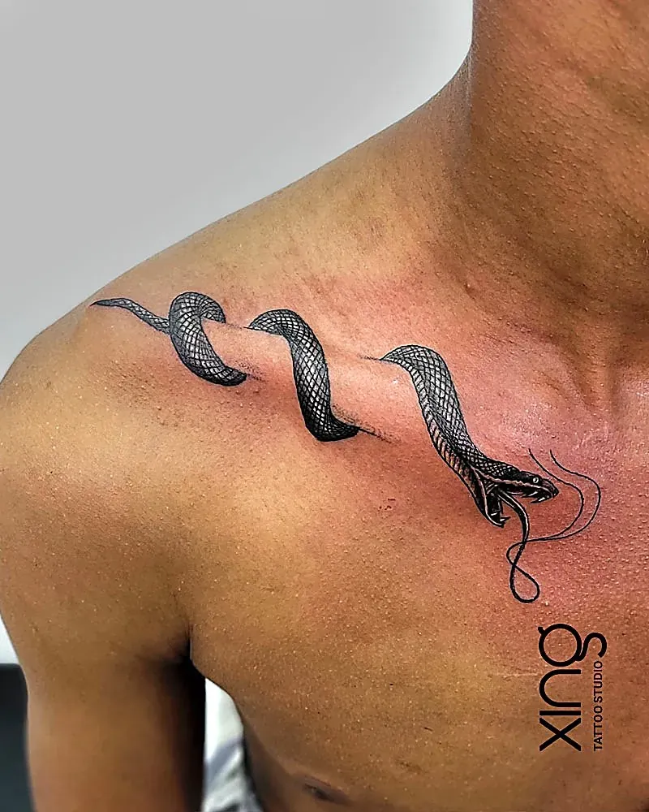

You've found the idea. Maybe it's a Pinterest board with fifty saved pins, maybe it's a doodle on a napkin, maybe it's a single photo you can't stop looking at. Between that idea and the moment the needle touches your skin, there's one crucial step most people rush: approving the tattoo sketch and the final stencil.

This guide explains how a rough idea becomes a custom design, how it's adjusted to your anatomy, how revisions work, how to check the stencil properly — and what tends to go wrong when this stage is skipped. It's the process every client follows at Xing Premium Tattoo Studio in Brookefield.

## How does a rough idea become a tattoo sketch?

Your references and story go in; a custom drawing sized for your body comes out. The artist doesn't copy a single picture — they combine what you love into one design.

**Typical starting points:**

- A Pinterest or Instagram board.
- Screenshots of tattoos you like.
- A rough doodle or handwriting.
- A photo of a person, pet or place.
- A word, date or symbol.

**What the artist takes from them:**

- The style — fine line, realism, geometric, script.
- The mood — bold, soft, playful, spiritual.
- The key elements — what must be in the design.
- What you *don't* like — just as important.

Our guide to [why a tattoo consultation matters](/blog/tattoo-consultation-what-happens) explains how this conversation happens.

## What should I check before I approve a tattoo sketch?

Check four things: meaning, size, flow and spelling. If all four are right, you're ready to approve.

| Check | Questions to ask yourself |
| --- | --- |
| Meaning | Does this say what I wanted it to say? Would I still love it alone? |
| Size | Will every detail and letter stay readable over time? |
| Flow | Does it follow the shape of my arm, back or leg? |
| Spelling | Are every name, word and date exactly right? |
| Balance | Is anything crowded, or anything missing? |
| Style | Is the line weight and shading what I expected? |

Take your time. Look at the sketch more than once, ideally on a different day, before you decide.

## How is a sketch adjusted to anatomy and flow?

The design is reshaped to follow your body's curves and movement, so it looks right when you're standing naturally — not just when you hold your arm out flat.

Common adjustments:

- **Stretching or narrowing** to fit a forearm, calf or spine.
- **Tilting** so the design follows the angle of the limb.
- **Curving** text along ribs or a collarbone.
- **Moving focal points** onto flat, broad areas.
- **Wrapping** details around joints rather than across them.
- **Leaving space** for future tattoos nearby.

For larger pieces, flow matters even more. Our post on [how long a custom sleeve takes](/blog/custom-sleeve-tattoo-sessions-timeline) explains how sleeves are mapped.

## How do revision rounds work?

You give feedback, the artist adjusts, you review again. Revisions are normal — they're how a good design becomes the right design.

**Giving useful feedback:**

1. Say what you love and want to keep.
2. Be specific about what to change — "make the moon smaller" beats "something feels off".
3. Mention size and placement concerns.
4. Double-check text and dates every round.
5. Don't ask for a completely new design at the last minute unless you need to.

**Signs you're ready to approve:**

- You keep coming back to the latest version.
- Your changes are getting smaller and smaller.
- You'd be happy seeing it every day.

> **Peace's tip:** Look at your sketch at actual size, not zoomed in on your phone. A design can look perfect on a screen and feel very different at the size it will be on your arm.

## What is a stencil, and how do I check it?

A stencil is the approved design transferred onto your skin as a temporary purple outline. It shows exactly where and how big the tattoo will be. Checking it is your last chance to change anything.

**Stencil checklist:**

- [ ] Stand naturally and look in a full-length mirror.
- [ ] Relax your arm or body — don't pose.
- [ ] Check it from the front, side and back.
- [ ] Is it straight, or at the angle you wanted?
- [ ] Is it too high, too low or off-centre?
- [ ] Is the size right for the placement?
- [ ] Read every word and number out loud.
- [ ] Take a photo and look at it again.

If anything's wrong, say so. The stencil can be removed and reapplied as many times as needed before tattooing starts.

## What goes wrong when sketch approval is skipped?

Wrong sizes, misspellings, crooked placement and designs that don't suit the body. Almost every one of these is avoidable with a proper sketch and stencil check.

**Common problems when this step is skipped:**

- Text too small to read after a few years.
- Misspelt names or wrong dates.
- Designs placed at an awkward angle.
- Fine details crowded so tightly they blur.
- A copied design that doesn't fit the body.

Fixing these later usually means a rework or a cover-up. Our [tattoo cover-up guide](/blog/tattoo-cover-up-guide) explains what's involved — and why getting it right first time is easier.

## Should a tattoo be a copy of a picture I found?

No. A reference is a starting point, not a template. Copying another artist's original work isn't fair to them, and a picture drawn for a flat screen rarely fits a curved body perfectly anyway.

Better approach:

- Collect references for style and mood.
- Tell the artist what you like about each.
- Add your own meaning — a date, initials, a symbol.
- Let the artist draw something new and yours.

Our comparison of [custom vs flash tattoos](/blog/custom-vs-flash-tattoo) explains why custom designs are worth the extra step.

## How do I approve script and lettering?

Check every letter, every space and every date format. Script is the most common place for mistakes, and the easiest to prevent.

- Write the exact text yourself, including capitals.
- Check names and dates against a reliable source.
- For Sanskrit, Hindi, Kannada or other scripts, ask a fluent reader to check.
- Read the stencil out loud before the needle starts.

Our guide to [script and calligraphy tattoo fonts](/blog/script-calligraphy-tattoo-fonts) explains spacing and size for lettering.

## What if I change my mind after approving?

Say so before the needle starts. Until the tattoo begins, the design can still be changed — it may mean rescheduling so the new version can be drawn properly, but that's far better than a tattoo you're unsure about.

Signs you should pause:

- You feel relief at the idea of postponing.
- You keep wanting to change the same element.
- Someone else chose the design, not you.
- You're doing it on a deadline you set in a rush.

Once the tattoo is done, changes become additions or reworks, so the stencil stage really is the last easy moment to adjust.

## Can I approve a design remotely?

Often, yes, for smaller pieces. The sketch can be shared on WhatsApp for feedback, and revisions can go back and forth there. For larger or complex designs, an in-person check of size and placement on your body is still worth the trip to AECS Layout.

Tips for approving on your phone:

- Ask for the sketch shown at actual size, or with a ruler for scale.
- Print it, or hold your phone against the placement in a mirror.
- Screenshot every version so you can compare them.

## How long should I take to approve a design?

As long as you need. There's no pressure to approve on the day. Sleep on it, look again, and come back with changes if you have them.

A few tips:

- Avoid deciding when you're rushed or excited.
- Show the sketch to someone you trust — but remember it's your tattoo.
- Re-read any text the next morning.

## How we do it at Xing

At Xing in Brookefield, approval is built into every tattoo:

1. **Free consultation** — your references, story, placement and size.
2. **Custom sketch** — drawn from scratch by Peace.
3. **Review and revisions** — you request changes to size, detail or placement.
4. **Final approval** — we only book once you're completely happy.
5. **Stencil check** — placed, checked in the mirror and moved until it's right.
6. **Session** — single-use needles opened in front of you, sealed US-imported inks, barrier-wrapped station.

Browse styles on our [tattoo services page](/services), or read more about Peace on the [tattoo artist page](/tattoo-artist).

## Conclusion: approve with confidence

Approving your tattoo sketch is the step that turns a good idea into the right tattoo. Check the meaning, size, flow and spelling, ask for revisions until it feels right, and check the stencil carefully before the needle starts. A little patience here saves years of "I wish I'd…".

For more quick answers, visit our [FAQ page](/faq).

Ready to talk about your idea? Book a free consultation at Xing {{landmark}} — or [WhatsApp us]({{whatsapp}}).
