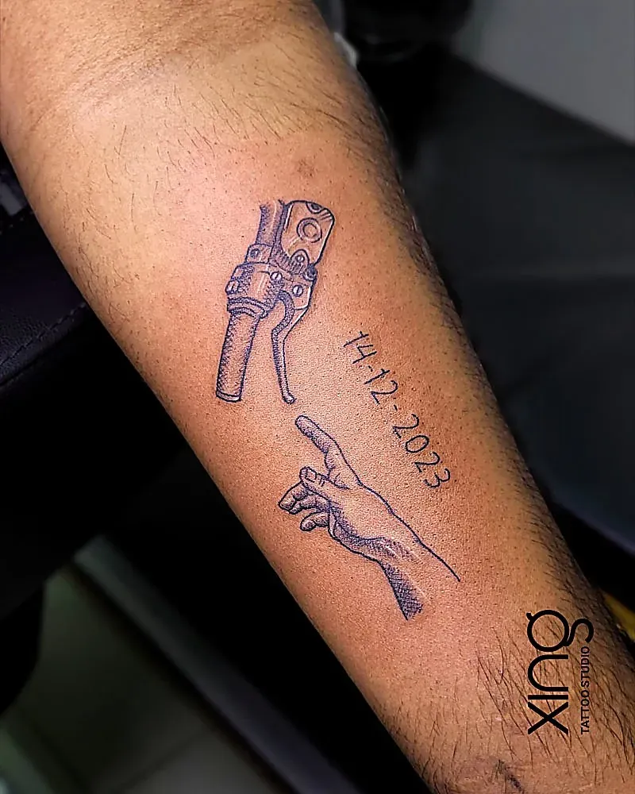

Some dates change your life: the day your child was born, the day you got the job, the day you finished treatment, the birthday that felt like a turning point. Milestone tattoos turn those moments into something you carry every day.

This guide is about celebrating — birthdays, career moves, new beginnings and personal wins. It covers design ideas, how to work dates and cultural motifs into a sketch, how to plan around the big day, and what to know if you'd like to gift a tattoo. If you're honouring someone who has passed away, our [memorial tattoo ideas](/blog/memorial-tattoo-ideas) guide is the better place to start.

## What are milestone tattoos?

Milestone tattoos mark an important life event — usually with a date, number or symbol that tells the story of that moment.

Popular milestones:

- Birthdays, especially the big ones — 18, 21, 30, 40, 50, 60.
- The birth or adoption of a child.
- Weddings and anniversaries.
- Graduations and qualifications.
- New jobs, promotions and starting a business.
- Moving to a new city — or coming home.
- Recovery from illness or a difficult time.
- Sporting achievements and personal records.

## What makes a milestone tattoo meaningful?

A meaningful milestone tattoo pairs a date or number with a symbol that explains why it matters. A date alone can feel plain; a symbol alone can lose its story.

**Simple formula:** date or number + symbol + (optional) a word or name.

| Milestone | Date idea | Symbol idea |
| --- | --- | --- |
| New baby | Birth date | Footprints, birth flower, name |
| Big birthday | Year or age in Roman numerals | Birth flower, zodiac, sun |
| New job or business | Start date | Arrow, mountain, compass |
| Recovery | Date of the turning point | Semicolon, lotus, rising sun |
| Graduation | Year | Book, owl, laurel |
| Wedding or anniversary | Wedding date | Rings, infinity, two flowers |
| Sporting win | Race or match date | The sport, a medal, a route line |

## How do I add a date without it looking plain?

Choose an interesting format, or tuck the date into a design. Roman numerals, handwritten dates and dates along a flower stem or heartbeat line all look more intentional than plain numbers.

Ways to style dates:

- **Roman numerals** — timeless and slightly hidden.
- **Handwritten** — in your own or a loved one's writing.
- **Typewriter style** — clean and minimal.
- **Along a line** — a stem, heartbeat, horizon or arrow.
- **Inside a banner or frame** — classic tattoo style.
- **Coordinates** — of the hospital, the office, the city.

Double-check the format — day-month-year or month-day-year — before the stencil goes on. Our guide to [script and calligraphy tattoo fonts](/blog/script-calligraphy-tattoo-fonts) explains how to keep numbers readable.

## How can cultural motifs be added to a milestone design?

Many clients weave in symbols from their culture, faith or family. Done respectfully, they make the tattoo feel rooted in who you are.

Ideas often requested in Bengaluru:

- **Om, Trishul or a lotus** for spiritual milestones.
- **A deity** connected to a family blessing or a prayer answered.
- **Script in Sanskrit, Hindi, Kannada or another language** for a word or mantra.
- **Rangoli or kolam-inspired patterns** around a date.
- **A family emblem or symbol** from your home state.

Always check the meaning and spelling with someone who knows the tradition. Our guides to [Indian traditional tattoos](/blog/indian-traditional-tattoos) and [Om, Trishul and spiritual designs](/blog/om-trishul-spiritual-tattoos) cover respectful placement.

## What are good baby and new-parent tattoos?

Footprints, handprints, the baby's name, birth flower and birth date are the most popular. Many parents combine two or three of these in one small design.

- **Footprints or handprints** — recreated from a real print.
- **Name in a parent's handwriting** — personal and warm.
- **Birth flower** — one for each child, added over the years.
- **Date in Roman numerals** — subtle and elegant.
- **Heartbeat line** — with the name or date.

Bring a clear print or a sharp photo so the details are accurate. Our guide to [small meaningful tattoos](/blog/small-meaningful-tattoos) has more symbol ideas.

## How do I plan a tattoo around a birthday or big day?

Book your consultation a few weeks before the date. That gives time for the sketch, changes, and choosing a session day that doesn't clash with celebrations.

**Planning timeline:**

1. **A few weeks before** — free consultation and sketch.
2. **The following week** — review and request changes.
3. **The week of the milestone** — your session, if timing works.
4. **After the session** — heal for a couple of weeks before beach holidays or swimming.

**Things to avoid:**

- Getting tattooed the day before a big party with drinking.
- Booking right before a holiday with swimming or strong sun.
- Choosing the design on the day itself.

## What is the studio atmosphere like for a celebration?

Calm, friendly and unhurried. At Xing, Peace works with one client at a time, so you can bring the excitement without the chaos.

Good to know before you visit:

- Peace handles every consultation, design and session personally.
- You can take breaks whenever you need them.
- Free Wi-Fi is available while you wait or rest.
- The studio has wheelchair-accessible seating and restroom.
- Payment by credit card, debit card or Google Pay is accepted.

If a friend or family member wants to come along for support, mention it when you book so we can plan space comfortably.

> **Peace's tip:** Celebrate after the tattoo, not before. A good meal before your session and a celebration dinner afterwards is perfect — just skip the alcohol until the next day.

## Can I gift someone a tattoo?

You can ask. Message us on WhatsApp at {{phone}} and we'll tell you how gifting can be arranged. The person receiving it should still choose their own design and placement at a free consultation.

Things to consider before gifting:

- Make sure they actually want a tattoo.
- Let them choose the design — a surprise design is risky.
- Check they're 18 or older.
- Consider gifting the consultation experience together.

## What are good milestone ideas for career wins and personal goals?

Symbols of movement, growth and strength suit career and personal milestones. Keep them simple and personal.

- **Arrow** — moving forward.
- **Mountain** — a challenge conquered.
- **Compass** — finding your direction. See our [travel tattoo ideas](/blog/travel-tattoo-ideas).
- **Rising sun** — a new beginning.
- **Phoenix** — rising after a hard time.
- **Lotus** — growth through difficulty.
- **A single word** — "begin", "brave", "breathe".

## How big should a milestone tattoo be?

Big enough for every number and letter to stay readable. Dates and names are small details, and small details are the first to blur if a design is squeezed too tight.

- **Dates alone** need clear spacing between digits — especially 6, 8, 9 and 0.
- **Footprints and handprints** need enough size for the toes and lines to stay distinct.
- **Symbol plus date** designs usually work best around palm-sized on the forearm.
- **Tiny wrist pieces** should stick to one short element — a date or a symbol, not both.

Peace will suggest the smallest size that keeps every detail clear. If you're torn between two sizes, the larger one usually ages better.

## Can I add more milestones later?

Yes, if you plan for it. Mention future milestones at the consultation so Peace can leave space or design something that grows.

Designs that grow well:

- A flower stem with room for more blooms.
- A constellation that adds stars.
- A timeline or heartbeat line that extends.
- A set of small symbols placed in a row.

## How do I care for my milestone tattoo?

Like any tattoo — gently and consistently. Small dates and fine text need particular care so numbers don't lose ink.

- Wash gently and pat dry.
- Apply a thin layer of aftercare product.
- Don't pick or scratch.
- Keep it out of the sun while healing.

Our [tattoo aftercare guide](/blog/tattoo-aftercare-guide) covers the full 30 days.

## How we do it at Xing

At Xing in Brookefield, milestone tattoos are designed around your story:

1. **Free consultation** — the moment, the date, the symbols and the placement.
2. **Custom sketch** — drawn from scratch by Peace.
3. **Date and spelling check** — confirmed with you before stencilling.
4. **Session** — single-use needles opened in front of you, sealed US-imported inks, barrier-wrapped station.
5. **Aftercare** — guidance and one free touch-up within 45–60 days if any part heals unevenly.

Baby footprints and portraits sit well with our [portrait tattoo service](/services/portrait). Read more about Peace on the [tattoo artist page](/tattoo-artist).

## Conclusion: wear your best moments

Milestone tattoos celebrate the moments that shaped you. Pair a date with a symbol that tells the story, add cultural details that matter to you, plan a few weeks ahead, and celebrate once the tattoo is done. If you'd like to gift one, just ask us how.

For more quick answers, visit our [FAQ page](/faq).

Ready to talk about your idea? Book a free consultation at Xing {{landmark}} — or [WhatsApp us]({{whatsapp}}).
