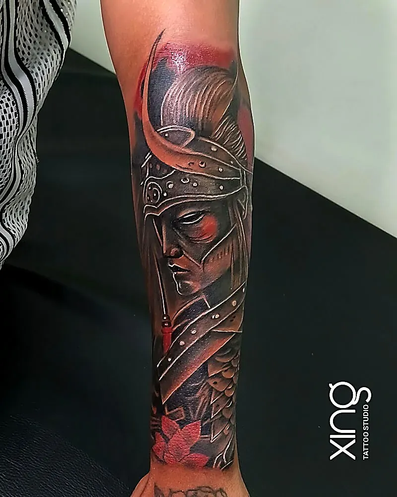

A custom sleeve tattoo is one of the biggest commitments you can make to your skin — and one of the most rewarding. The question everyone asks first is simple: how long will it take? Not just the hours in the chair, but the weeks and months from first sketch to finished arm.

This guide breaks down the stages of a sleeve, how long each session usually runs, how much healing time to leave between sittings, and how to pace the project around your budget and life. It focuses on time and sessions. For themes, half vs full sleeves and body mapping, read our guide on [how to plan a sleeve tattoo](/blog/sleeve-tattoo-planning).

## How long does a custom sleeve tattoo take?

A custom sleeve tattoo usually takes several sessions spread over a few months. Each session tackles one stage, and you heal for a few weeks between sittings.

The total depends on:

- **Coverage** — quarter, half or full sleeve.
- **Style** — bold blackwork moves faster than realism.
- **Detail** — portraits, textures and soft gradients take the longest.
- **Your skin** — some people heal faster than others.
- **Your stamina** — how long you can comfortably sit.

At Xing Premium Tattoo Studio in Brookefield, you get a clear session plan at your free consultation, so you know what to expect before you start.

## What are the stages of a sleeve tattoo?

Most sleeves move through four stages: design and stencil, outline, shading, then background and finishing. Some styles combine stages; realism often adds more shading sessions.

| Stage | What happens | What you'll notice |
| --- | --- | --- |
| 1. Design and stencil | Peace draws the sleeve to fit your arm and maps it with stencils | No ink yet; you approve the layout |
| 2. Outline | Main shapes and line work go in | The sleeve's structure appears |
| 3. Shading | Depth, gradients and contrast are built | The design starts to look three-dimensional |
| 4. Background and finishing | Fillers, textures and transitions connect everything | Gaps close; the sleeve reads as one piece |
| Touch-up | Any patches that healed unevenly are refined | Clean, finished result |

Not every sleeve goes in that exact order. Sometimes Peace outlines and shades one section at a time, especially for large realism pieces. The plan is made around your design.

## Why does the design stage take time?

Because a sleeve has to flow around a moving, curved arm. The design is drawn to fit your shoulder, elbow, forearm and wrist, not a flat sheet of paper.

During the design stage:

1. You share your theme, references and the story behind the sleeve.
2. Peace sketches how the main elements will sit and connect.
3. Key elements are placed where they look best — large images on broad areas, flowing details around joints.
4. You review the plan and request changes.
5. Stencils are applied and checked with your arm relaxed and moving.

Our post on [how to approve your tattoo sketch](/blog/approve-tattoo-sketch-stencil) explains how to review a design properly before it's inked.

## How many hours is each sleeve session?

Detailed sessions for realism and large-scale work commonly run about 3–7 hours per sitting. Some clients prefer shorter sessions, which simply means more visits.

**What affects session length:**

- **The stage** — outline sessions can move faster than shading.
- **The placement** — inner arm and elbow areas are slower and more sensitive.
- **Your comfort** — breaks are normal, and you can stop when you need to.
- **Detail density** — faces, fur and textures take time.

**Making long sessions easier:**

- Eat a full meal beforehand and bring snacks.
- Drink water throughout the day.
- Sleep well the night before.
- Wear clothes that give easy access to the whole arm.
- Bring headphones or something to watch.

## How long should I heal between sleeve sessions?

Leave a few weeks between sessions on the same area, so the skin has closed and settled before it's worked on again. Tattooing over half-healed skin damages both the old and new work.

**Typical rhythm:**

- Session on the forearm → heal for a few weeks.
- Next session can sometimes go on a fresh part of the arm sooner.
- Returning to an area already tattooed waits until it has healed.

Healing time also lets Peace see how the ink has settled on your skin. Contrast that looks right on day one can look different once healed, and the next session can adjust for it.

Our [tattoo aftercare guide](/blog/tattoo-aftercare-guide) covers how to heal each section properly.

## How long does the whole sleeve take, start to finish?

From first consultation to the final touch-up, most custom sleeves take a few months. Complex realism sleeves can take longer, especially with gaps for travel, work or budget.

**A sample timeline (for illustration only):**

| Phase | Typical timing |
| --- | --- |
| Consultation and design | First couple of weeks |
| Outline session(s) | Weeks 2–4 |
| Healing break | A few weeks |
| Shading session(s) | Following months |
| Background and finishing | After shading has healed |
| Touch-up | After everything has fully healed |

Your own plan may be shorter or longer. It's better to take your time and heal properly than to rush and compromise the result.

## How does Peace plan the flow of a sleeve?

Peace plans the sleeve as one story mapped around your arm, so every element connects and the design reads well from every angle — front, back and side.

What goes into the flow:

- **Main focal points** on the broad, flat areas: outer forearm, outer upper arm and shoulder.
- **Flowing elements** like smoke, clouds, waves or patterns wrapping around joints.
- **Contrast balance** so dark and light areas are spread evenly.
- **Room to grow** if you might extend a half sleeve later.
- **Direction** so the design follows the natural lines of your muscles.

> **Peace's tip:** Think about how your arm is seen most often — resting at your side. I design the main image to read well in that position, not just when you hold your arm out for a photo.

## How do I budget and pace a sleeve?

Pay per session and pace sittings around your finances and schedule. The natural healing gaps give you time to rest and save between stages.

**Budget and pacing tips:**

- [ ] Ask for a session plan and quote at the consultation.
- [ ] Ask how payment works per session.
- [ ] Book the first sessions, then plan the rest as you go.
- [ ] Avoid sessions right before travel, exams or big work deadlines.
- [ ] Don't cut the design down to save money — pause instead.
- [ ] Keep aftercare products and loose clothes ready for each healing break.

Our [tattoo cost in Bengaluru guide](/blog/tattoo-cost-in-bangalore) explains how size, detail and time affect a quote.

## What sleeve styles take longest?

Realism and portrait sleeves usually take the most sessions, because of layered shading and fine detail. Bold blackwork, tribal and simple geometric sleeves are usually faster.

- **Realism and portraits** — most sessions, longest sittings.
- **Black and grey with mixed elements** — moderate to long.
- **Geometric and mandala** — precise linework, moderate time.
- **Tribal and blackwork** — bold fills, often faster.
- **Japanese-inspired** — large, flowing elements plus backgrounds; varies widely.

If you're choosing between styles, our comparison of [Japanese Irezumi vs realism sleeves](/blog/japanese-irezumi-vs-realism-sleeve) can help.

## Can I add to an existing tattoo to make a sleeve?

Often, yes. Peace can design around existing pieces, blend them into the background or rework them so the sleeve looks like one connected design.

Bring clear photos of your existing tattoos to the consultation. Old, faded or uneven work may need rework first, which can add a session. Our [tattoo cover-up guide](/blog/tattoo-cover-up-guide) explains what's possible.

## How we do it at Xing

At Xing, every sleeve is designed, mapped and tattooed by Peace personally — {{years}} years of experience and {{tattoos}} tattoos completed.

1. **Free consultation** — theme, references, existing tattoos and a session plan.
2. **Custom design** — drawn from scratch to flow around your arm.
3. **Stencil mapping** — checked with your arm relaxed and in motion.
4. **Sessions** — single-use needles opened in front of you, sealed US-imported inks, barrier-wrapped station, breaks whenever you need them.
5. **Healing support** — aftercare guidance and WhatsApp check-ins between sessions.
6. **Finishing** — one free touch-up within 45–60 days if any part heals unevenly.

See sleeve-friendly styles on our [black and grey tattoo page](/services/black-grey), or meet Peace on the [tattoo artist page](/tattoo-artist).

## Conclusion: a sleeve is a journey, not a day

A custom sleeve tattoo takes several sessions and a few months — and that's a good thing. Each stage gets the attention it needs, your skin heals properly between sittings, and the design is refined as it grows. Plan the stages, pace your budget, and enjoy watching it come together.

Have more questions? Visit our [FAQ page](/faq).

Ready to talk about your idea? Book a free consultation at Xing {{landmark}} — or [WhatsApp us]({{whatsapp}}).
