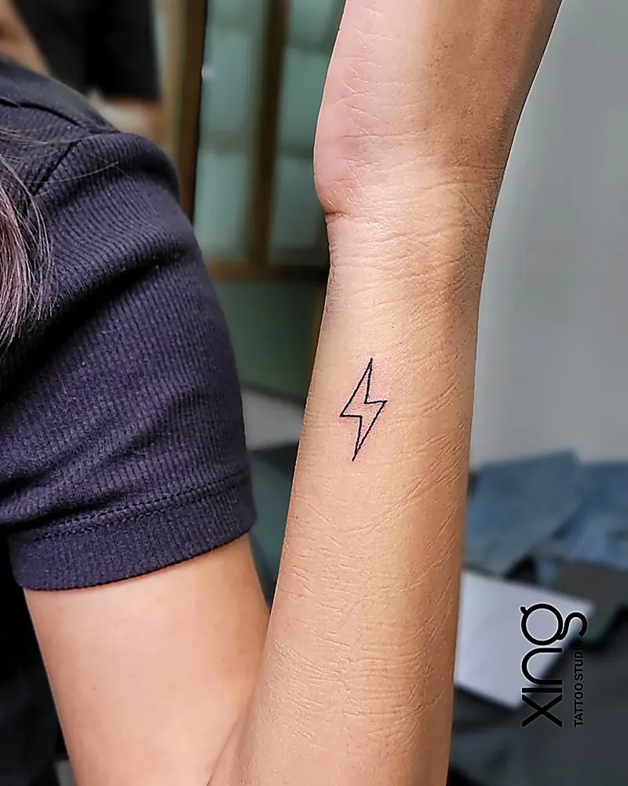

This first tattoo guide answers the questions every beginner in Bengaluru asks: how to choose a design, what size and placement work best, how to find a safe studio, what happens in the chair, how much it hurts and how to care for it after.

Getting your first tattoo is exciting — and a little nerve-wracking. That's completely normal. Most of our first-time clients walk in nervous and walk out wondering why they waited so long.

We tattoo first-timers every week at our studio in Brookefield. This is everything we tell them, in one place.

## Choosing a meaningful design

Your first tattoo doesn't need a deep story, but it should be something you'll still like in ten or twenty years.

Start by asking yourself a few simple questions:

- What do I want this tattoo to remind me of?
- Is there a person, place, belief or moment I want to carry with me?
- Do I want something visible every day, or private?
- Do I like delicate, minimal designs or bold, detailed ones?

**Popular first tattoo ideas include:**

- A meaningful word, date or name in clean script.
- A small symbol — lotus, Om, infinity, semicolon, arrow, moon.
- A flower or botanical piece.
- A tribute to a parent, grandparent or pet.
- Coordinates of a place that matters to you.

Avoid choosing a design purely because it's trending. Trends change; your skin doesn't.

For more ideas, see our [minimalist tattoo ideas for first-timers](/blog/minimalist-tattoo-ideas).

> **Peace's tip:** Save your design idea as your phone wallpaper for a few weeks. If you still love it after seeing it every day, you're ready.

## Size and placement for beginners

For a first tattoo, choose a size and placement that are comfortable to sit through and easy to heal.

**Good first-timer placements:**

| Placement | Pain level | Visibility | Why it works |
| --- | --- | --- | --- |
| Outer forearm | Low–medium | Visible | Flat, firm, easy to care for |
| Upper arm / shoulder | Low | Easy to hide | Good padding, low pain |
| Calf | Low–medium | Easy to hide | Plenty of space |
| Upper back | Medium | Hidden | Large, flat area |
| Inner wrist | Medium | Visible | Popular for small designs |

**Placements that need more thought for a first tattoo:** ribs, feet, hands, fingers, neck and spine. These can be more painful, heal more slowly or fade faster.

Size matters too. Very small tattoos with lots of detail can blur over time as ink spreads slightly under the skin. Your artist may suggest making the design a little bigger to keep it crisp.

Our [tattoo pain chart](/blog/tattoo-pain-chart) compares every major placement.

## Finding the right studio

This is the most important decision you'll make. Look for:

- **A real portfolio** with healed work in the style you want.
- **Strict hygiene** — single-use needles opened in front of you, barrier film, sterilised tools.
- **An experienced artist** who will tattoo you personally.
- **Custom design** rather than copying from the internet.
- **Honest communication** about size, placement and ageing.
- **Clear aftercare support** after your session.

Our checklist on [how to choose a tattoo studio in Brookefield](/blog/best-tattoo-studio-brookefield) covers all ten checks in detail.

When you're getting a tattoo in Bengaluru, distance matters less than quality. A short extra ride is worth it for a studio you trust.

## The consultation: turning your idea into a design

A consultation is a conversation with the artist before any tattooing happens. At most good studios, it's free.

**Bring with you:**

- One to three reference images.
- A clear idea of the placement.
- A rough size in inches.
- Any meaning or story behind the design.

**Ask the artist:**

1. Will this design work at this size and placement?
2. How will it look in five or ten years?
3. How long will the session take?
4. What aftercare will I need?
5. Is there anything I should avoid before the session?

The artist will then sketch a custom design, size it to your body and show it to you before the stencil goes on. You can ask for changes at this stage — that's what it's for.

## Preparing for the day

What you do the day before matters. Our full [tattoo appointment prep checklist](/blog/tattoo-appointment-prep) covers it in detail, but here are the basics:

- **Sleep well** the night before.
- **Eat a proper meal** one to two hours before your session.
- **Drink plenty of water** in the days leading up.
- **Avoid alcohol** for at least 24 hours before.
- **Check with your doctor** if you take medication, especially blood thinners.
- **Wear comfortable clothes** that give easy access to the placement.
- **Carry a photo ID** — studios usually need to confirm you are 18 or older.
- **Bring a snack and water** for longer sessions.

Don't apply heavy lotion or oil to the area on the day. If you have a cold, fever, or skin irritation where you want the tattoo, reschedule.

## What happens in the chair

Here is a typical first tattoo session, step by step:

1. **Final design check.** You confirm the design, size and placement.
2. **Skin prep.** The artist cleans and, if needed, shaves the area.
3. **Stencil.** The design is transferred onto your skin. You check it in the mirror and can ask for it to be moved.
4. **Setup.** The artist opens a new needle in front of you, pours fresh ink into new caps and covers equipment in barrier film.
5. **Tattooing.** The artist starts with outlines, then adds shading or colour. You can ask for short breaks.
6. **Clean and wrap.** The tattoo is cleaned and covered with a protective wrap.
7. **Aftercare briefing.** You get instructions on washing, moisturising and what to avoid.

Small tattoos can take under an hour. Larger, detailed pieces can take several hours.

## Pain expectations

Yes, it hurts a bit — but usually less than first-timers expect.

Most people describe tattoo pain as a scratching, stinging or vibrating feeling. It's most noticeable in the first few minutes, then your body adjusts.

Pain depends on:

- **Placement** — bony areas and thin skin hurt more.
- **Session length** — longer sessions get more tiring.
- **Your state** — being tired, hungry or anxious makes it feel worse.
- **The style** — heavy shading can feel more intense than linework.

Breathe slowly, keep still, and tell your artist if you need a break. If you're thinking about numbing creams, ask the artist first — some products can affect how the skin takes ink.

## Aftercare basics

Your tattoo is a fresh wound for the first couple of weeks. Good aftercare protects the design and your health.

**The basics:**

- Keep the wrap on for the time your artist recommends.
- Wash gently with clean hands, lukewarm water and mild, fragrance-free soap.
- Pat dry with a clean paper towel.
- Apply a thin layer of the aftercare product your artist suggests.
- Don't scratch, pick or peel flakes.
- Avoid swimming pools, the sea and long hot showers for at least two weeks.
- Keep it out of direct sun while healing.
- Wear loose, clean clothing over the area.

Watch for signs of infection — spreading redness, worsening pain, pus or fever — and see a doctor promptly if they appear.

Our day-by-day [tattoo aftercare guide](/blog/tattoo-aftercare-guide) walks you through all 30 days.

## First tattoo guide: mistakes to avoid

Learn from others. These are the most common first tattoo regrets we hear about:

- **Choosing the cheapest studio** without checking hygiene or portfolio.
- **Going too small** with too much detail, so it blurs.
- **Copying a design** from the internet exactly.
- **Not checking spelling** on names, dates and scripts.
- **Drinking alcohol** the night before.
- **Skipping aftercare** or picking at peeling skin.
- **Going straight to the beach or pool** after the session.
- **Rushing the decision** because a friend is getting one.

## Black and grey, colour or fine line?

Most first tattoos are black ink, but it's worth knowing your options before the consultation.

**Fine line** uses thin, delicate lines with little or no shading. It's elegant and popular for small symbols, florals and script. Fine line needs a skilled hand and the right size, or it can blur over the years.

**Black and grey** uses black ink diluted into soft greys for shading. It suits almost everything — portraits, animals, spiritual designs — and tends to age gracefully on Indian skin tones.

**Colour** adds brightness and can make florals, watercolour pieces and nature designs pop. Colours need more sun protection to stay bright, and some shades show more clearly on certain skin tones than others.

If you're unsure, ask your artist to sketch the same idea in two styles. Seeing them side by side often makes the choice obvious.

## Talking to family about your first tattoo

For many people in India, a first tattoo also means a conversation at home. That's normal, and a little planning helps.

- **Explain the meaning.** A tattoo with a story — a tribute, a spiritual symbol, a reminder — is easier for family to understand.
- **Show the design.** A clean, professional sketch is more reassuring than a vague description.
- **Talk about safety.** Parents often worry about hygiene. Explain that you've chosen a studio with single-use needles and sterilised tools.
- **Choose placement thoughtfully.** Some people start with a spot that's easy to cover at family functions.
- **Be patient.** Opinions often soften once people see the tattoo and how much it means to you.

You must be 18 or older at most professional studios, including ours, and you may be asked for photo ID.

## Your first tattoo checklist

Save this list and tick it off as you go:

- [ ] I've chosen a design I've loved for at least a few weeks.
- [ ] I know roughly how big I want it, in inches.
- [ ] I've chosen a placement that suits my work and lifestyle.
- [ ] I've checked the studio's portfolio and hygiene.
- [ ] I've had a consultation and approved the design.
- [ ] I've slept well, eaten and avoided alcohol.
- [ ] I'm carrying photo ID, water and a snack.
- [ ] I know my aftercare routine.
- [ ] I've cleared my calendar of swimming and beach trips for two weeks.

## After your first tattoo: the next few weeks

Your first few weeks with a tattoo are part of the experience. Here's what usually happens.

**Week one** is about keeping it clean and lightly moisturised. It may feel like a mild sunburn.

**Week two** brings peeling and itching. It's tempting to scratch — don't. Tap gently instead.

**Weeks three and four** are when the tattoo may look a little cloudy. That's new skin settling over the ink, and it clears.

**After a month**, your tattoo is ready to show off. Take a photo in natural light — that's how it will look for years.

Many people find they start planning their second tattoo before the first has even finished healing. If that's you, take your time with the next design too.

**Related guides:** Before your first session, read [what happens at a tattoo consultation](/blog/tattoo-consultation-what-happens) and [how to approve your tattoo sketch](/blog/approve-tattoo-sketch-stencil). Our guide to the [post-tattoo crash](/blog/post-tattoo-adrenaline-crash) covers how you might feel afterwards.

## How we do it at Xing

At Xing in AECS Layout, first tattoos are some of our favourite sessions.

Your consultation is free. Peace listens to your idea, suggests sizes and placements that will age well, and sketches a design from scratch. You approve it before anything touches your skin.

Every needle is single-use and opened in front of you. Inks are sealed and skin-tested. The workstation is covered in barrier film and re-wrapped between every client.

Peace explains each step as he goes and gives you breaks whenever you need them. You leave with clear aftercare guidance, and you can message us on WhatsApp with any questions while you heal.

## Conclusion: take your time, then enjoy it

Your first tattoo should feel exciting, not stressful. Choose a design you love, a placement that suits your life, and a studio you trust. Prepare well, follow aftercare, and your tattoo will look good for years.

If you're getting a tattoo in Bengaluru for the first time and live around Brookefield, Whitefield or Marathahalli, we'd love to help you plan it. Take a look at our [fine-line and minimalist tattoo work](/services/minimalist), or read our [tattoo FAQ](/faq) for quick answers.

Ready to talk about your idea? Book a free consultation at Xing {{landmark}} — or [WhatsApp us]({{whatsapp}}).
