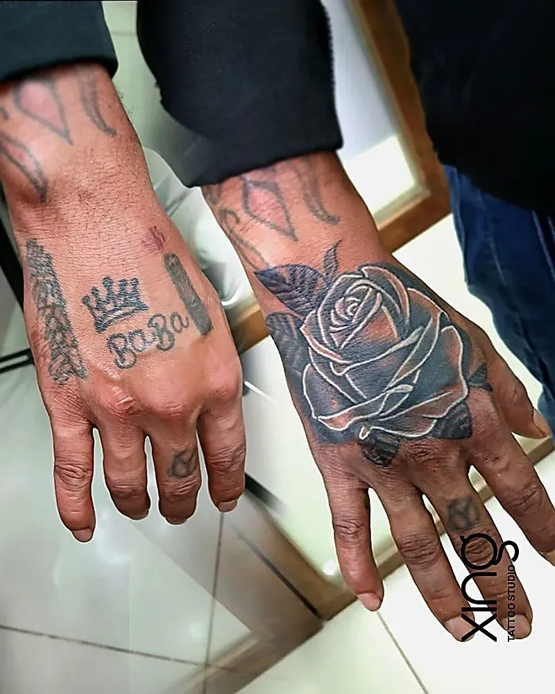
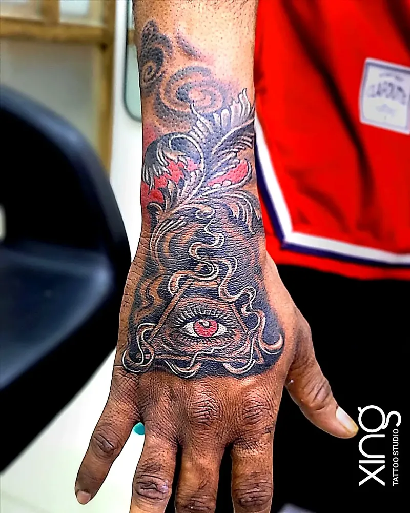

A finger tattoo or hand tattoo looks bold and stylish, but it fades faster than tattoos almost anywhere else. Constant washing, friction and fast-renewing skin wear down ink quickly. Bold, simple designs, smart placement and planned touch-ups are the keys to making hand and finger tattoos last.

At our studio in Brookefield, Bengaluru, we're always honest about hand and finger tattoos. They can look great — as long as you know what to expect.

## Why hands fade

Hands go through more wear than any other part of your body.

- **Frequent washing.** Soap, water and sanitiser many times a day.
- **Friction.** Hands constantly touch, grip and rub against objects.
- **Fast-renewing skin.** Skin on the fingers and palms sheds and rebuilds quickly.
- **Sun exposure.** Hands are rarely covered.
- **Thin skin over bone.** Ink can spread or blow out more easily.
- **Movement.** Knuckles and joints bend constantly.

All of this means hand tattoo fading happens sooner than on the arm, back or leg.

## Where on the hand fades fastest

| Area | Fading | Notes |
| --- | --- | --- |
| Back of the hand | Moderate | Best spot for hand tattoos |
| Top of fingers | Moderate–fast | Good for small, bold designs |
| Sides of fingers | Fast | Often fades or blurs |
| Knuckles | Fast | Constant bending |
| Palms | Very fast | Often heals unevenly |
| Inner fingers (between) | Very fast | Rubbing and moisture |

## Design rules: bold and simple

Hand and finger tattoos last longest when designs are:

- **Bold** — thicker lines hold better than very fine ones.
- **Simple** — fewer details, so less can blur together.
- **Well spaced** — gaps between lines and letters.
- **Solid where possible** — filled shapes last longer than thin outlines.
- **Sized properly** — not too tiny for the detail.

**Good hand and finger designs:**

- Small symbols — stars, hearts, crowns, moons.
- Single letters or initials.
- Bold geometric shapes.
- Simple mandala on the back of the hand.
- A rose or flower on the back of the hand with solid shading.

**Designs to avoid on fingers:**

- Long words or sentences.
- Very fine line work.
- Tiny, detailed images.
- Light colours.

> **Peace's tip:** For finger tattoos, I'll usually suggest slightly bolder lines and fewer details than you might expect. A design that looks heavy on day one often looks just right after it settles — and lasts far longer.

## Healing on hands

Healing hand tattoos is tricky because you use your hands all day.

- **Wash gently** after every hand wash with mild, fragrance-free soap.
- **Pat dry** and apply a very thin layer of aftercare product.
- **Avoid harsh sanitisers** directly on the tattoo while healing.
- **Wear gloves** for cleaning, cooking with spices or handling chemicals.
- **Avoid rings** on tattooed fingers until healed.
- **Keep it out of the sun.**
- **Expect swelling** for a few days — keep your hand raised when you can.

Our [tattoo aftercare guide](/blog/tattoo-aftercare-guide) covers the full routine.

## Touch-up expectations

Be realistic: most hand and finger tattoos will need touch-ups.

- **After healing:** some areas may heal lighter or patchy, especially on the sides of fingers.
- **Over time:** lines may soften or spread.
- **Planning:** budget time for occasional refresh sessions.

Our guide to [tattoo touch-ups and rework](/blog/tattoo-touch-up-rework) explains what to expect.

## Work visibility

Hand tattoos are one of the most visible placements. Unlike arm or back tattoos, they're hard to cover.

- **Check workplace rules** — especially in client-facing, government or uniformed roles.
- **Think about family and cultural events.**
- **Consider starting elsewhere** if you're unsure — the wrist or forearm are easier to cover.

Our guide to [visible tattoos at work in India](/blog/tattoos-at-work-india) explains more, and our [wrist tattoo ideas](/blog/wrist-tattoo-ideas) offer a less visible alternative.

## Hand tattoos and mehendi

Many clients in India ask about mehendi. Avoid applying mehendi on or near a fresh tattoo until it's fully healed. Once healed, mehendi on surrounding skin is generally fine — but if you have sensitive skin, check with a dermatologist about reactions to dyes, especially "black henna," which can contain harsh chemicals.

## Hand and finger tattoo checklist

- [ ] I've chosen a bold, simple design.
- [ ] I'm placing it on the back of the hand or top of fingers, not the sides or palm.
- [ ] I understand it may need touch-ups.
- [ ] I've thought about work and family visibility.
- [ ] I can follow careful aftercare for two to four weeks.

## Finger tattoo ideas that last

If you're set on a finger tattoo, these designs tend to hold up best:

- **A bold single initial** on the top of the finger.
- **A small solid heart or star.**
- **A simple crown** with thick lines.
- **A tiny moon** filled in solid black.
- **A short band or ring** design with bold lines.
- **Dots or simple geometric shapes** across the knuckles.

Keep them on the top of the fingers rather than the sides, and accept that they may need refreshing every so often.

## Alternatives to hand tattoos

If you love the look but are worried about fading or visibility, consider:

- **The wrist** — visible, but easier to cover with a watch.
- **The inner forearm** — great for small designs you can show or hide.
- **Behind the ear** — tiny and subtle.
- **The ankle** — small and delicate.

Our list of [30 minimalist tattoo ideas](/blog/minimalist-tattoo-ideas) includes designs that suit these placements.

## Hand tattoos and everyday chores

Daily tasks are hard on fresh hand tattoos. While healing, wear gloves for washing dishes, cleaning and gardening, avoid handling raw spices like chilli and turmeric, and keep your hands away from harsh cleaning products. Pat the tattoo dry after every wash and reapply a thin layer of aftercare product. If you work with your hands all day, consider booking your session just before a few days off, so the tattoo gets a calmer start to healing.

## How we do it at Xing

At Xing, Peace gives honest advice on hand and finger tattoos — including when a design would last better elsewhere. Designs are drawn from scratch with bolder lines and smart spacing for longevity.

Needles are single-use and opened in front of you, inks are sealed and skin-tested, and if any part of your tattoo heals unevenly, we offer a free touch-up. See our [geometric tattoo work](/services/geometric) for bold hand mandalas.

## Conclusion

A finger tattoo or hand tattoo can look striking, but hands fade fast. Choose bold, simple designs, place them on the back of the hand or top of the fingers, follow careful aftercare and expect touch-ups. And think about visibility before you commit.

If you're considering a hand tattoo in Bengaluru — around Brookefield, AECS Layout or Marathahalli — come in for a free consultation and honest advice.

Ready to talk about your idea? Book a free consultation at Xing {{landmark}} — or [WhatsApp us]({{whatsapp}}).
