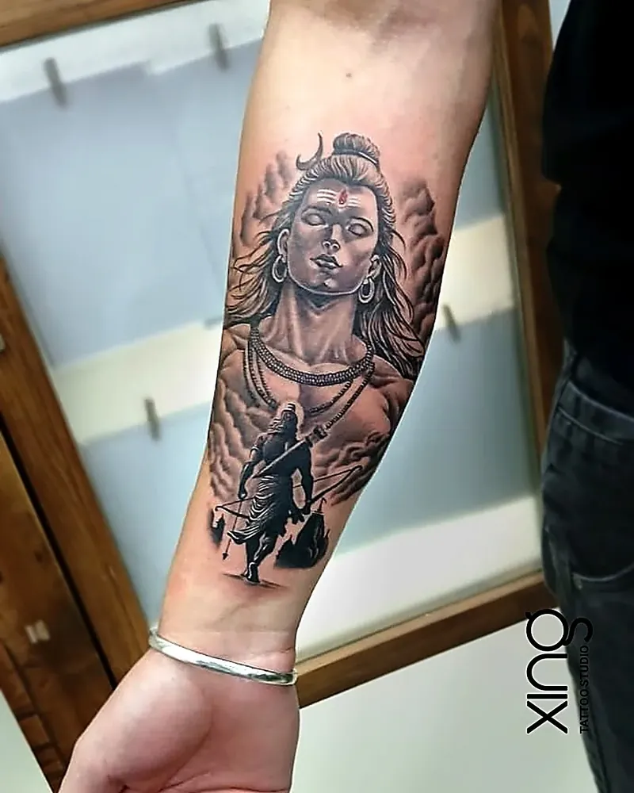

Peace — full name Chingri Awungshi — is the tattoo artist in Brookefield behind every piece at Xing. With {{years}} years of experience, he handles every consultation, design and session personally, from fine-line first tattoos to detailed realism and spiritual work.

This post shares the confirmed facts about Peace and how he works. For his full profile and portfolio, visit the [artist page](/tattoo-artist).

## Peace, tattoo artist in Brookefield, at a glance

| | |
| --- | --- |
| Name | Peace |
| Role | Lead Tattoo Artist |
| Experience | {{years}} years |
| Studio | Xing, AECS Layout, Brookefield, Bengaluru |
| Google rating (studio) | {{stars}} |
| Who tattoos you | Peace, personally — every session |

## Peace's journey

What we can share with confidence is simple: Peace has been tattooing for more than 15 years, and today he leads the studio in AECS Layout, Brookefield. Every tattoo at the studio is designed and inked by him.

Clients often mention the same things in their Google reviews: patience, care, clear aftercare advice and the ability to make nervous first-timers feel comfortable. You can read [what clients say](/#reviews) on our homepage.

We'll add more about Peace's story here as he shares it in his own words.

## Styles he works in

Peace works across a wide range of styles, each linked to a service page:

- **[Realism](/services/realism)** — layered shading and contrast that reads like a photograph: statues, wildlife and deities with real depth.
- **[Portraits](/services/portrait)** — faces of people and pets built from your reference photo, with the eyes and expression treated as the priority.
- **[Black and grey](/services/black-grey)** — smooth grey washes and deep blacks for sleeves, back pieces and cover-ups that age evenly.
- **[Fine line and minimal](/services/minimalist)** — single-needle linework, script and small symbols, clean and precise for first tattoos.
- **[Geometric and mandala](/services/geometric)** — stencils mapped to your body's curve so symmetry holds.
- **[Indian traditional](/services/traditional)** — Shiva, Ganesha, Om, Trishul and Sanskrit script, drawn with respect for the meaning and placement.

Our [realism tattoo guide](/blog/realism-tattoos-guide) explains what goes into photo-real work.

## His approach to consultation

At the studio, the approach to every tattoo follows a few clear values:

- **Design before ink.** Nothing goes on skin until the design is right. Every piece is sketched from scratch, sized to your body and reviewed with you first.
- **One artist, full attention.** Every consultation, stencil and session is handled by Peace — no handoffs, no rotating chairs.
- **Honest advice.** Straight answers on size, placement and how a design will age, even when that means reworking the idea.
- **Respect for meaning.** Memorials, deities, names and scripts are treated with care — spelling checked, placement discussed, symbolism respected.

> **Peace's tip:** Tell me the story behind your tattoo, not just the picture. The story is what helps me decide what to draw, what to leave out and where it should sit on your body.

## Hygiene standards

Peace's sessions follow the studio's hygiene standards every time:

- Single-use, disposable needles — opened in front of you.
- Sealed, skin-tested inks imported from the US.
- Medical-grade sterilisation for every reusable tool.
- Barrier film on the machine, cables, bottles and workstation.
- Workstation fully cleaned and re-wrapped between every client.

Our [hygienic tattoo studio checklist](/blog/hygienic-tattoo-studio-checklist) explains why each of these matters.

## Aftercare that continues

You get clear aftercare guidance to take home, and you can message the studio on WhatsApp while you heal. If any part of your tattoo heals unevenly, the studio offers a free touch-up.

## Favourite pieces

The best way to see Peace's work is the studio's real portfolio. Every photo in our [tattoo gallery](/#gallery) was tattooed at the studio — from fine-line florals and lettering to Shiva portraits, geometric sleeves and memorial pieces.

If you'd like to see work in a particular style, ask at your consultation. Peace can show you more examples in person.

## Book with Peace

Peace works at Xing, {{landmark}} — an easy ride from Whitefield, ITPL and Marathahalli.

Studio hours: {{hours}}. Consultations are free, and you can start on WhatsApp.

## First-timers in the chair

Many of the studio's clients are getting their very first tattoo. Peace's approach for first-timers is simple:

- Talk through the design, size and placement until you're sure.
- Explain each step before it happens.
- Start with a short test line if you're nervous.
- Take breaks whenever you need them.
- Explain aftercare clearly before you leave.

Our [first tattoo guide for Bengaluru](/blog/first-tattoo-guide-bangalore) covers what to expect.

## Spiritual and memorial work

Some of the most meaningful pieces at the studio are spiritual and memorial tattoos — Shiva and Hanuman portraits, Om and Trishul designs, and tributes to parents, grandparents and pets. These are planned carefully, with spellings checked and placement discussed. Our guides to [Indian traditional tattoos](/blog/indian-traditional-tattoos) and [memorial tattoo ideas](/blog/memorial-tattoo-ideas) share more.

## What to bring when you meet Peace

- Your idea, in a sentence or two.
- One to three reference images.
- A photo of the placement area.
- Any text, with exact spelling.
- Photo ID — you must be 18 or older.

## Reviews and reputation

The studio is rated {{stars}} on Google. Reviews mention first tattoos, anniversary gifts, clean and professional sessions, detailed aftercare advice and Peace's patience with nervous clients. We encourage you to read the reviews yourself and to visit the studio before deciding — the best way to judge any artist is to meet them.

## Planning a larger project with Peace

For sleeves, back pieces and large realism, Peace plans the full design at the start and splits it into sessions with healing time between. Before each session, the design is reviewed together so every part connects smoothly. If you have existing tattoos nearby, bring photos so the new work can link with them or leave space around them. Our guide to [planning a sleeve tattoo](/blog/sleeve-tattoo-planning) explains how large projects come together.

## How we do it at Xing

At Xing, the artist you consult with is the artist who tattoos you. Peace sketches every design from scratch, checks every stencil on your body and follows the same hygiene process for every client. Our guide to [how a custom tattoo is made at Xing](/blog/custom-tattoo-process) walks through each step.

## Conclusion

If you're looking for a tattoo artist in Brookefield or anywhere in East Bengaluru, Peace brings {{years}} years of experience, a custom-design approach and strict hygiene to every tattoo. The best way to know if he's the right artist for you is to meet him and talk about your idea.

Visit the [artist page](/tattoo-artist) for more, or browse the [tattoo gallery](/#gallery).

If you'd like to see more of his work first, browse the gallery on our home page before you book.

Ready to talk about your idea? Book a free consultation at Xing {{landmark}} — or [WhatsApp us]({{whatsapp}}).
