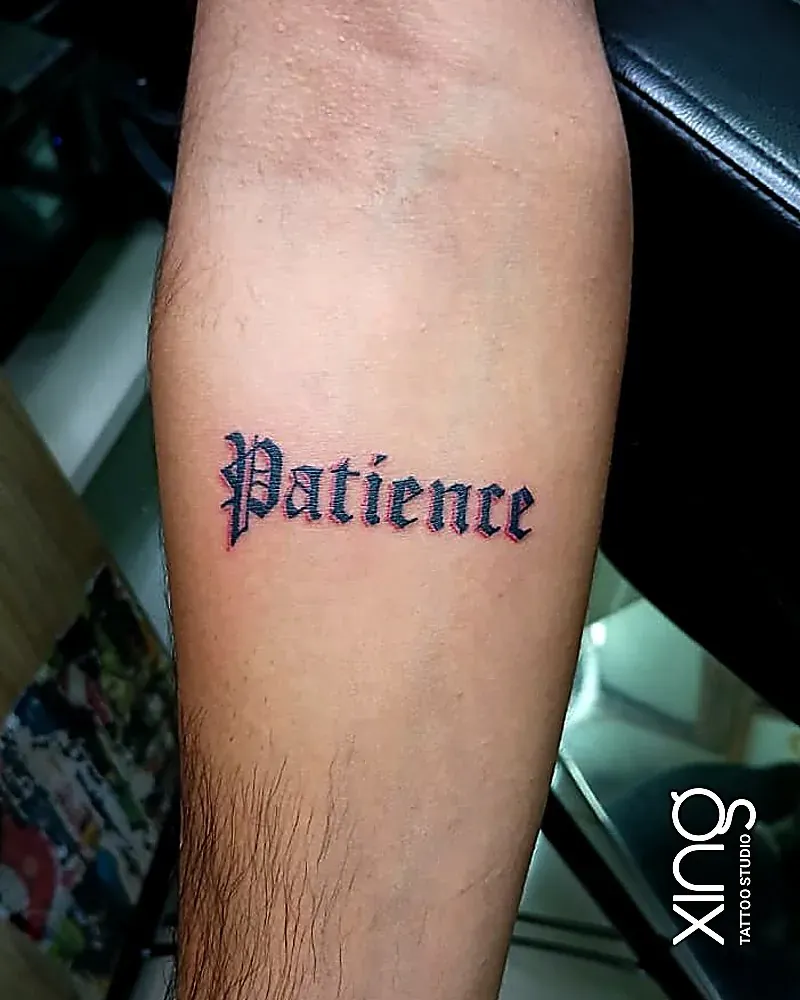
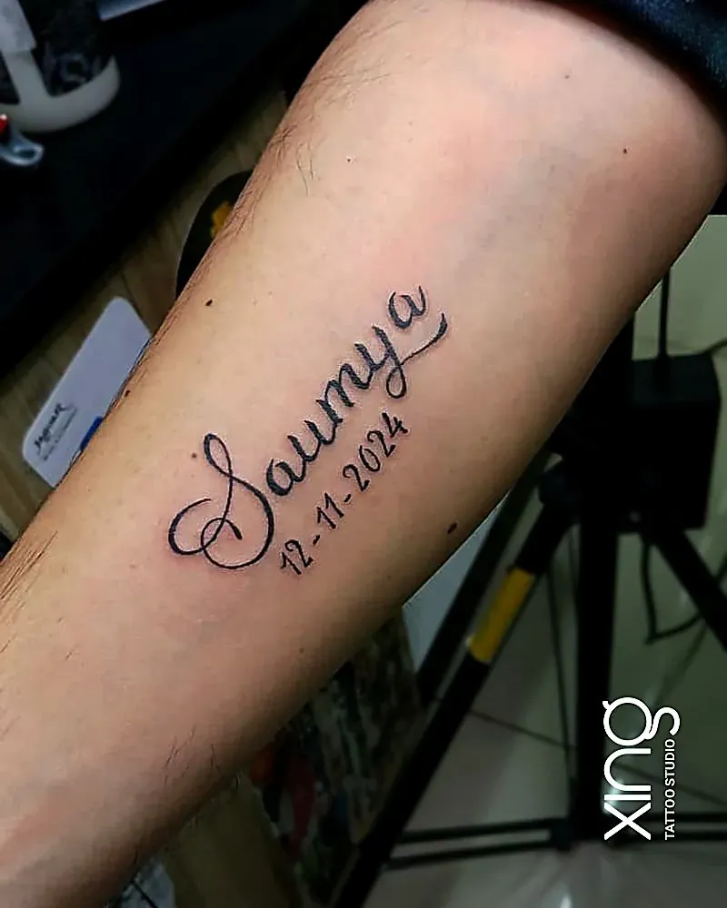

A great name tattoo comes down to three things: a font that suits the words, a size that keeps every letter readable as it ages, and spelling that's checked and double-checked — especially in Hindi, Sanskrit, Kannada or any regional script.

Name and lettering tattoos are some of the most personal designs we create at our studio in Brookefield, Bengaluru. A child's name, a parent's handwriting, a word that got you through a hard year — they all carry meaning in just a few letters.

Here's how to plan yours well.

## Choosing a font

The font changes the whole feeling of a tattoo. The same word can look delicate, bold, classic or modern depending on how it's lettered.

| Font style | Feel | Best for | Watch out for |
| --- | --- | --- | --- |
| Fine script | Elegant, romantic | Names, short words | Loops can close if too small |
| Bold script | Confident, flowing | Names, mottos | Needs space |
| Serif | Classic, timeless | Quotes, dates | Small serifs blur at tiny sizes |
| Sans-serif / print | Clean, modern | Small words, coordinates | Can look plain without good spacing |
| Gothic / blackletter | Strong, dramatic | Short mottos, surnames | Hard to read if too small |
| Typewriter | Vintage, minimal | Quotes, dates | Thin strokes may soften |
| Handwriting | Personal, emotional | Tributes, signatures | Needs cleaning up for skin |

Look at the word written in two or three different fonts before deciding. Your artist can sketch options for you.

## Size for legibility

Letters are small shapes packed close together. As a tattoo ages, ink spreads slightly, and tiny letters can merge.

**General tips:**

- **Give script fonts more height.** Loops in letters like "e", "a" and "o" need space to stay open.
- **Leave space between letters and lines** so they don't blur together.
- **Keep text short** for small placements — one or two words.
- **Avoid tiny serifs** on very small text.
- **Go bigger for long quotes** — the forearm, ribs or back give room.

Your artist will show the stencil at the real size on your skin so you can check how readable it looks.

## Hindi, Sanskrit and regional scripts — check spelling

Lettering in Devanagari, Kannada, Tamil, Telugu, Malayalam, Bengali, Gurmukhi or any other script is beautiful — and easy to get wrong if nobody checks it.

**Before your session:**

1. **Get the text from a fluent, trusted reader** — a parent, grandparent, teacher or priest.
2. **Bring it handwritten or clearly printed** by that person.
3. **Confirm the meaning of every word.**
4. **Don't rely only on online translators** — they often make mistakes with names and grammar.
5. **Check the stencil carefully** against your source before tattooing starts.

In scripts like Devanagari, a single missing matra or a misplaced line can change a name or make it unreadable. It's worth the extra step.

> **Peace's tip:** For regional scripts, I always ask clients to send a photo of the text written by someone who reads it fluently. I build the lettering from that, and we compare the stencil character by character before I start.

Our guide to [Om, Trishul and spiritual tattoos](/blog/om-trishul-spiritual-tattoos) covers mantra and Sanskrit script tattoos in more detail.

## Name tattoo ideas

Some popular ways to make a name tattoo special:

- **A child's name** with their birth date.
- **A parent's name** in their own handwriting.
- **Initials** woven into a small symbol.
- **A partner's name** — or a word that represents your relationship (many people choose a symbol instead of a name).
- **A pet's name** with a paw print.
- **Your own surname** in bold lettering.
- **A name in your mother tongue** to honour your roots.

## Placement for lettering

| Placement | Good for | Notes |
| --- | --- | --- |
| Inner forearm | Names, short quotes | Easy to read yourself |
| Outer forearm | Bold words | Visible to others |
| Collarbone | Short script | Elegant, a little more painful |
| Ribs | Vertical or longer quotes | More painful, easy to hide |
| Upper back / below the neck | Mottos, surnames | Bold fonts work well |
| Wrist | One or two words | Fades faster with washing and sun |
| Behind the ear | Initials | Tiny text needs simple fonts |
| Fingers | Initials, tiny words | Fades quickly; needs touch-ups |

Think about who the text is for. Words on the inner forearm read the right way for you. Words on the outer forearm or back read the right way for others.

## Spacing and ageing

Good lettering is as much about the space around the letters as the letters themselves.

- **Letter spacing** keeps words readable.
- **Line spacing** stops stacked lines from merging.
- **Stroke thickness** that's consistent ages more evenly.
- **Bold strokes** usually last longer than very thin ones.

Fine script can look stunning when fresh but soften faster. A slightly bolder version often looks better in five or ten years. Our [fine line tattoo guide](/blog/fine-line-tattoos) explains why.

## Common lettering mistakes

- **Spelling errors**, especially in names and regional scripts.
- **Going too small**, so letters blur together.
- **Choosing a hard-to-read font** for a long quote.
- **Cramming too many words** into a small space.
- **Ignoring direction** — text curving the wrong way on the body.
- **Getting a partner's name** without thinking long-term. Many cover-ups we see are old names.
- **Copying a celebrity's tattoo** exactly, instead of making it personal.

If you have an old name tattoo you'd like to change, our [tattoo cover-up guide](/blog/tattoo-cover-up-guide) explains what's possible.

## Lettering tattoo checklist

- [ ] The words are final and spelled correctly.
- [ ] Regional script has been checked by a fluent reader.
- [ ] I've seen the text in at least two fonts.
- [ ] The size keeps every letter readable.
- [ ] I've chosen whether it should read for me or for others.
- [ ] I've checked the stencil letter by letter.

## Combining lettering with designs

Words often look best when they're part of a larger design. A name can sit under a portrait, a date can wrap around a flower stem, and a mantra can frame a deity. Keep the lettering simple when it's paired with a detailed image, so the two don't compete for attention.

## How we do it at Xing

At Xing, names and scripts are treated with care — spellings are checked, placement is discussed and every stencil is reviewed with you before tattooing begins. Peace draws lettering from scratch, sized for your placement so it stays readable as it ages.

Needles are single-use and opened in front of you, and inks are sealed and skin-tested. See our [minimalist and fine-line work](/services/minimalist) for small script pieces.

## Conclusion

A name tattoo or lettering piece can say a lot in a few words. Pick a font that matches the feeling, give the letters enough size and space, check spelling carefully — especially in Indian scripts — and place it where it reads the way you want.

If you're planning a lettering tattoo in Bengaluru, whether you're in Brookefield, AECS Layout or Marathahalli, bring your words and references for a free consultation. You can also read about [memorial tattoo ideas](/blog/memorial-tattoo-ideas) that combine names and dates.

Ready to talk about your idea? Book a free consultation at Xing {{landmark}} — or [WhatsApp us]({{whatsapp}}).
