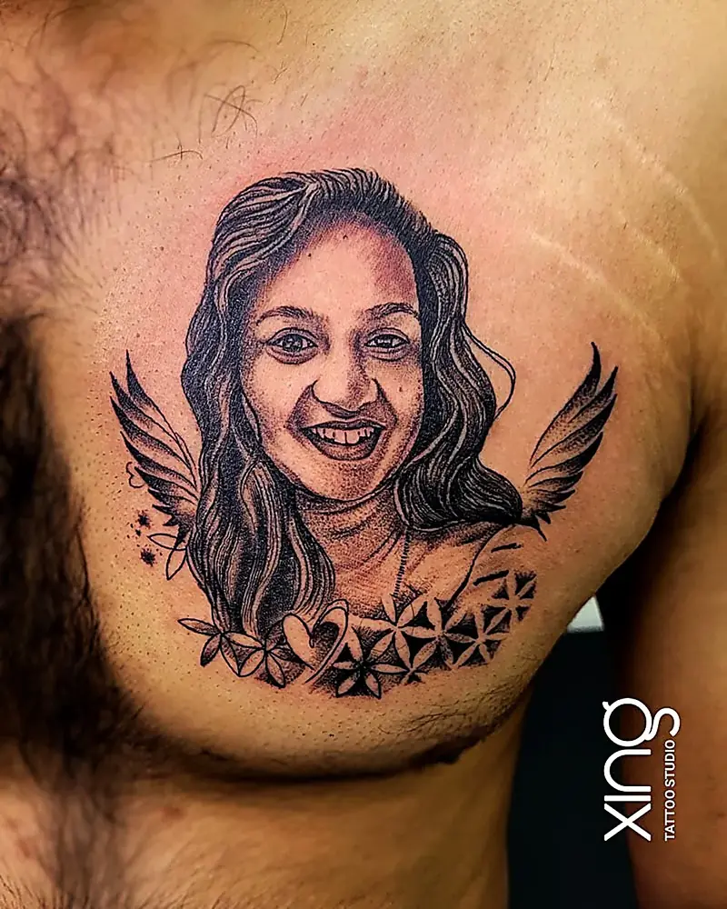
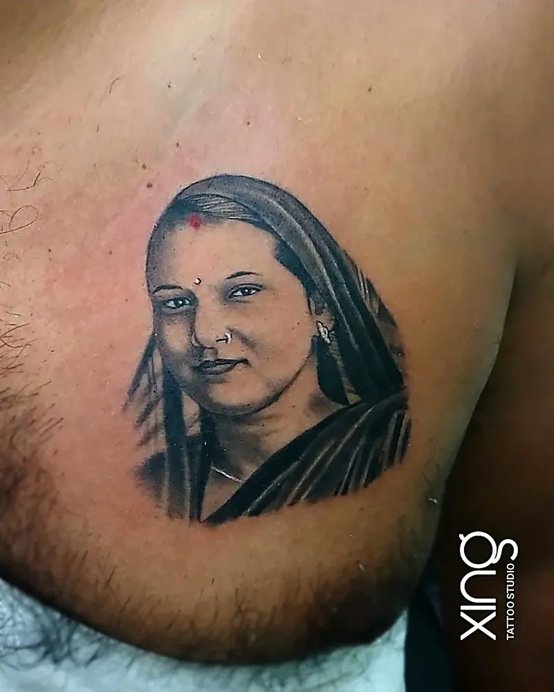

The right reference photo is the most important part of a portrait tattoo. Choose a sharp, high-resolution original with natural lighting, clear shadows and the face large in the frame — and your artist has everything they need to make the portrait look like the person.

Portraits are deeply personal. They're often of parents, grandparents, children, partners or pets. Getting them right matters.

Here's how to choose a photo, from our studio in Brookefield, Bengaluru.

## Why the photo decides your portrait tattoo

A portrait tattoo is recreated from the image you bring. If details aren't in the photo, the artist has to guess — and guessing is how portraits stop looking like the person.

Your artist needs to see:

- The exact shape of the eyes and eyebrows.
- How light falls on the nose, cheeks and chin.
- Fine details like smile lines, a dimple or a scar.
- The direction of hair and how it frames the face.

The clearer these are in the photo, the more recognisable the portrait.

## Resolution, lighting and angle

**Resolution.** Use the original photo file, not a screenshot or a forwarded copy. Images sent through messaging apps lose quality each time.

**Lighting.** Natural daylight from one side is ideal. It creates gentle shadows that give the face shape. Avoid harsh flash, dark rooms and strong coloured lighting.

**Angle.** A face looking straight on or turned slightly (a three-quarter view) usually works best. Extreme angles from below or above can distort features.

**Focus.** The eyes must be sharp. If the eyes are blurry, the portrait will lack life.

**Expression.** A natural expression often looks better on skin than a forced smile. Choose a photo that feels like the person.

> **Peace's tip:** Bring three or four photos, not just one. I'll pick the one with the best detail, and sometimes borrow the eyes from one and the smile from another to capture the person you remember.

## Photo checklist

Before your consultation, check your photo against this list:

- [ ] It's the original, full-resolution file.
- [ ] The face fills a good part of the frame.
- [ ] The eyes are in sharp focus.
- [ ] Lighting is natural, with soft shadows.
- [ ] There are no beauty filters or heavy edits.
- [ ] Nothing important is covered — hair, hands or objects over the face.
- [ ] The angle is straight on or slightly turned.

If your only photo is old, blurry or damaged, bring it anyway. Your artist can tell you honestly what's possible.

## Size needed for detail

Faces have a lot of fine detail packed into a small area. Too small, and features merge as the tattoo ages.

**General guide:**

| Portrait type | Suggested minimum size |
| --- | --- |
| Single face, close-up | About palm-sized |
| Face with shoulders | Forearm length |
| Two faces together | Larger — forearm, thigh or chest |
| Portrait with background scene | Half sleeve or back panel |

Your artist will adjust these suggestions to your photo and placement.

## Placement for portraits

Portraits look best on flat, stable areas where the skin doesn't twist or stretch much.

**Good placements:**

- Inner or outer forearm.
- Upper arm.
- Chest — a popular spot for tributes to parents and children.
- Calf.
- Upper back or shoulder blade.

**Harder placements:** ribs, inner elbow, hands and the neck, where movement and thin skin distort features.

Our guide to [realism tattoos](/blog/realism-tattoos-guide) explains more about placement for photo-real work.

## Editing or combining photos

Sometimes the perfect photo doesn't exist. That's where design comes in.

Your artist can often:

- Brighten or adjust contrast in a dark photo.
- Remove distractions from the background.
- Combine a face from one photo with a pose from another.
- Add elements like wings, flowers, dates or names.
- Turn a colour photo into black and grey.

For a memorial portrait, these small changes can make the tattoo feel more personal. Our guide to [memorial tattoo ideas](/blog/memorial-tattoo-ideas) has more ways to honour someone.

## Healing and touch-ups

Portrait tattoos have a lot of fine shading, so careful aftercare is essential.

- Wash gently and moisturise lightly as your artist advises.
- Never pick at peeling skin — it can lift ink from fine details like eyes.
- Expect a cloudy stage for a couple of weeks; detail returns as the skin settles.
- Keep it out of direct sun while healing, and use sunscreen once healed.

After healing, a small touch-up can sharpen highlights or deepen shadows if needed.

## Photos that don't work well — and what to do

Some photos are hard to turn into a good portrait tattoo. Common problems include:

- **Group photos** where the face is tiny. Zooming in loses detail.
- **Old prints** that are faded, scratched or creased.
- **Sunglasses or shadows** hiding the eyes.
- **Strong beauty filters** that smooth away natural features.
- **Low light** photos with grain and noise.

If one of these is all you have, don't give up. Bring the original print if possible — a good scan can recover more detail than a phone photo of a photo. Your artist may also suggest a softer, sketch-style portrait that suits the image better than full realism.

## Colour or black and grey portraits

Most portrait tattoos are done in black and grey. It gives a timeless, photographic look and ages gracefully on most skin tones.

Colour portraits can be stunning too, especially for eye colour, flowers or backgrounds. They need more sun protection to stay vivid and may need occasional touch-ups.

If your photo is in colour, your artist can still convert it to black and grey for the design.

## Planning portrait sessions

A detailed portrait often takes several hours. Larger pieces may be split into two sessions, with healing time between.

Eat well, sleep well and bring water and a snack. Plan two weeks without swimming or long sun exposure afterwards. If the portrait is emotional for you, let your artist know — it's okay to take breaks.

**Related guides:** Planning a small portrait? Our guide to [micro-realism tattoos](/blog/micro-realism-tattoos) explains how size and contrast affect tiny faces.

## How we do it at Xing

At Xing, portraits start with your photos and a conversation about the person.

Peace treats the eyes and expression as the priority, then builds the face from your reference. You see the design sized to your body before the stencil goes on. Needles are single-use and opened in front of you, and inks are sealed and skin-tested.

You can see examples on our [portrait tattoo service page](/services/portrait), including memorial and pet portraits.

## Conclusion

A great portrait tattoo starts with a great photo: sharp, well lit, high resolution and showing the face clearly. Add the right size and placement, and you'll have a tribute that looks like the person for years.

If you're planning a portrait tattoo in Bengaluru, from Brookefield or nearby Marathahalli, bring your photos for a free review. You can also read about [pet portrait tattoos](/blog/pet-portrait-tattoos) or browse our [tattoo gallery](/#gallery).

Ready to talk about your idea? Book a free consultation at Xing {{landmark}} — or [WhatsApp us]({{whatsapp}}).
