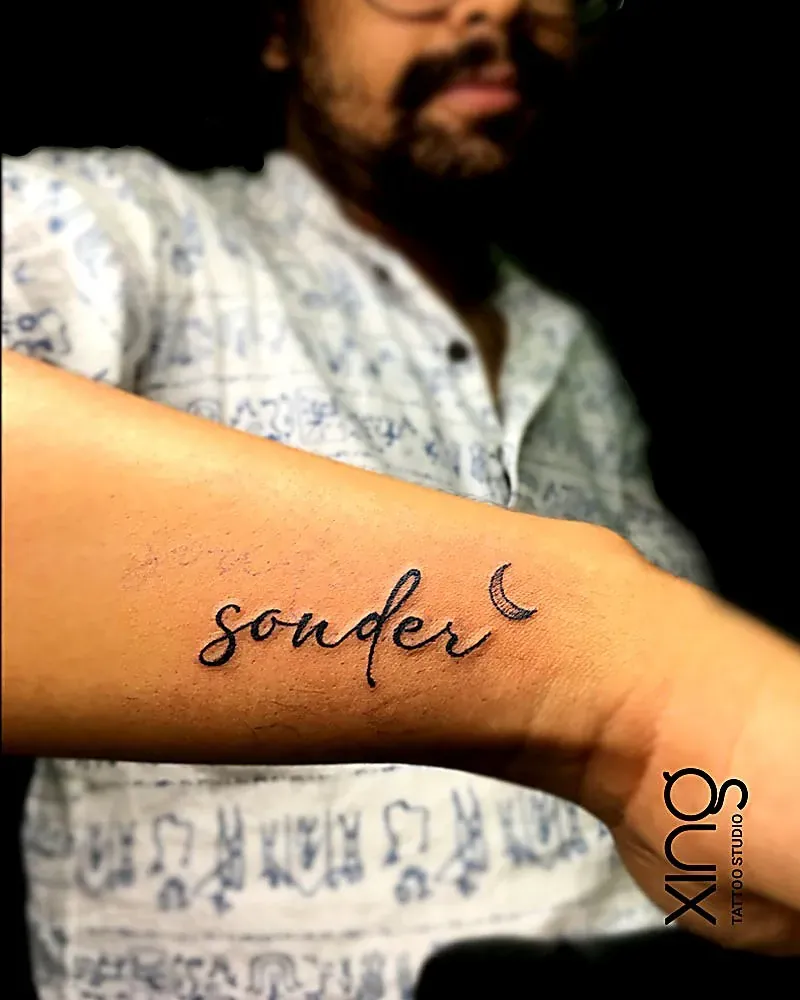
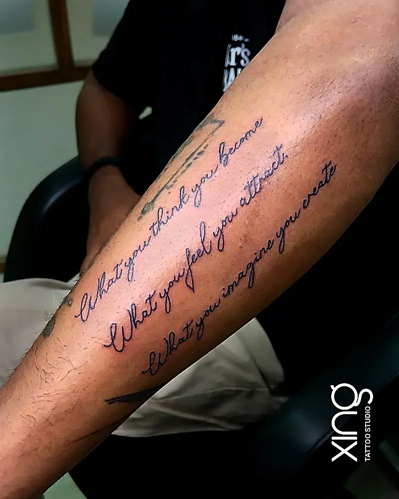

Words are some of the most personal tattoos anyone gets — a name, a date, a mantra, a line from a song, a parent's handwriting. But words are also unforgiving. A beautiful calligraphy tattoo that looks perfect on day one can blur into an unreadable smudge in a few years if the font, size or placement is wrong.

This guide explains how to choose a script or calligraphy tattoo font that lasts: why spacing matters more than style, how cursive, typewriter and bold lettering age differently, which placements suit which fonts, and how custom lettering and handwriting are adapted for skin.

## Why do some script and calligraphy tattoos blur over time?

Because ink spreads very slightly under the skin over the years. Letters that are too small, too close together or full of tiny closed loops are the first to blur together.

What causes script to lose clarity:

- **Tight spacing** — letters touch as lines soften.
- **Small closed loops** — the inside of an "e", "a" or "o" fills in.
- **Hair-thin strokes** — fade or break up.
- **Too many letters in a small space** — everything merges.
- **High-friction or high-sun areas** — fingers, hands and feet fade faster.

None of this means script can't last. It means the design has to plan for ageing from the start. Our [fine line tattoo guide](/blog/fine-line-tattoos) explains the same principle for thin linework.

## What are the main script tattoo font styles?

Most script tattoos fall into four families: cursive, typewriter, bold or blackletter, and native-language scripts. Each one ages and reads differently.

| Font style | Looks | Ages | Best for |
| --- | --- | --- | --- |
| Delicate cursive | Personal, elegant, flowing | Needs space; thinnest strokes soften first | Forearm, ribs, collarbone |
| Bold script | Confident, readable | Holds well | Forearm, chest, back |
| Typewriter / serif | Clean, minimal, modern | Good if letters are well-spaced | Inner forearm, ankle, spine |
| Blackletter | Dramatic, traditional | Very readable; solid strokes | Chest, back, upper arm |
| Sanskrit, Hindi, Kannada and other scripts | Spiritual, cultural | Depends on stroke weight | Forearm, back, spine |

There's no "best" font — only the best font for your words, size and placement.

## Cursive, typewriter or bold: which should I choose?

Choose cursive for warmth and personality, typewriter for clean minimalism, and bold or blackletter when readability over decades is your top priority.

**Cursive suits you if:**

- You want something soft and personal.
- You have room for a slightly larger size.
- You love flowing, connected letters.

**Typewriter suits you if:**

- You want a minimal, modern look.
- The text is short — a word, a date, a short phrase.
- You like clean, even spacing.

**Bold or blackletter suits you if:**

- You want the words to read clearly from a distance.
- The placement is large, like the chest or back.
- You want a classic tattoo feel.

## How does placement change the font choice?

Placement decides how much room the letters get, how much they move, and how much sun and friction they face. Big, flat areas forgive more; small, busy areas forgive less.

**Generous placements for script:**

- **Forearm** — the most popular spot; great for one line or a few stacked lines.
- **Ribs** — lovely for flowing cursive, but sensitive.
- **Collarbone** — elegant for a short word or phrase.
- **Spine and back** — vertical or long horizontal text.
- **Upper arm** — easy to show or hide.

**Tight placements for script:**

- **Fingers** — very limited space; fades faster.
- **Inner wrist** — thin skin and lots of movement.
- **Side of the hand and feet** — high friction.
- **Behind the ear** — small and curved.

For tight placements, choose fewer letters and a simpler, slightly bolder font. Our [tattoo pain chart](/blog/tattoo-pain-chart) also shows which areas are more sensitive.

## How much spacing do letters need?

More than most people expect. Leave clear gaps between letters, open up the loops and keep consistent stroke weight, so the word still reads in ten years.

**Spacing rules Peace works with:**

1. Letters should not touch, except where cursive naturally connects.
2. Closed loops in small letters should be opened slightly.
3. Line height should leave space between stacked lines.
4. Thin decorative flicks should be kept short.
5. Dots on "i" and "j" need breathing room too.

> **Peace's tip:** If you're torn between two sizes, choose the bigger one. With script, a little extra size is the difference between a word that reads clearly in ten years and one you have to explain.

## Can I get custom lettering or a loved one's handwriting?

Yes. Custom lettering and real handwriting are some of the most meaningful script tattoos. The original is cleaned up and adjusted so it ages well while keeping its character.

**How handwriting tattoos work:**

1. **Bring a clear photo or scan** — a card, letter or note.
2. **Choose the words** — sometimes a signature or a single line is enough.
3. **Clean-up** — shaky lines, ink blots and paper texture are smoothed.
4. **Spacing adjustments** — letters gently opened up so they don't merge.
5. **Sizing** — fitted to your placement.
6. **Review** — you check that it still feels like their writing.

Handwriting tattoos are often memorial pieces. Our guide to [memorial tattoo ideas](/blog/memorial-tattoo-ideas) shares other ways to honour someone.

## How do I make sure the spelling and script are right?

Bring the exact text, double-check it yourself, and for any language you don't read fluently, have a native reader confirm it. At Xing, the spelling and letterforms are confirmed with you before stencilling.

**Spelling checklist before your session:**

- [ ] Write the exact text, including capital letters and punctuation.
- [ ] Check names, dates and date formats (day-month or month-day?).
- [ ] For Sanskrit, Hindi, Kannada or other scripts, use a trusted source.
- [ ] Ask a fluent reader to check the final stencil.
- [ ] Read the stencil on your skin, out loud, before the needle starts.

For spiritual text like Om or mantras, our guide to [Om, Trishul and spiritual tattoos](/blog/om-trishul-spiritual-tattoos) covers respectful placement and design.

## Should I add dates, numbers or Roman numerals?

Yes, they're some of the most popular additions — but numbers need the same spacing care as letters. Small digits like 6, 8, 9 and 0 have closed loops that can fill in.

- **Arabic numerals** — choose an open, simple style and keep them slightly larger than the text beside them.
- **Roman numerals** — clean and timeless, but long dates get wide; check the full length on your arm first.
- **Date formats** — decide on day-month-year or month-day-year before the stencil, and write it down.
- **Separators** — dots and dashes are easy to lose; give them room.

## Can script be combined with images?

Yes. Script pairs well with small symbols, dates, flowers or line art. Keep the text and image balanced so neither crowds the other.

Popular combinations:

- A name with a small heart, heartbeat line or infinity sign.
- A date under a portrait or flower.
- A mantra running alongside a lotus or Trishul.
- A short quote along the edge of a larger piece.

## How do I care for a script tattoo?

The same way as any tattoo, with extra care not to pick, because missing ink is very noticeable in letters. Keep it out of the sun while healing and use sunscreen afterwards.

- Wash gently and pat dry.
- Apply a thin layer of aftercare product.
- Don't pick or scratch — a missing patch can change a letter.
- Use sunscreen once healed, especially on hands and forearms.

See our [tattoo aftercare guide](/blog/tattoo-aftercare-guide) for the full routine.

## How we do it at Xing

At Xing in Brookefield, Peace designs every script tattoo from scratch:

1. **Free consultation** — your words, their meaning and the placement.
2. **Font and size advice** — honest guidance on what will stay readable.
3. **Custom lettering** — drawn or adapted from handwriting.
4. **Spelling check** — confirmed with you before stencilling.
5. **Session** — single-use needles opened in front of you, sealed US-imported inks, barrier-wrapped station.
6. **Aftercare** — guidance and one free touch-up within 45–60 days if any part heals unevenly.

See delicate work on our [fine-line and minimalist page](/services/minimalist), or read about Peace on the [tattoo artist page](/tattoo-artist).

## Conclusion: words that stay readable

A calligraphy tattoo lasts when the font, size and placement work together. Give letters room to breathe, match delicate fonts to generous placements, keep tight spots simple, and check every letter before the needle starts. Then your words will read as clearly in twenty years as they do today.

For more quick answers, visit our [FAQ page](/faq).

Ready to talk about your idea? Book a free consultation at Xing {{landmark}} — or [WhatsApp us]({{whatsapp}}).
