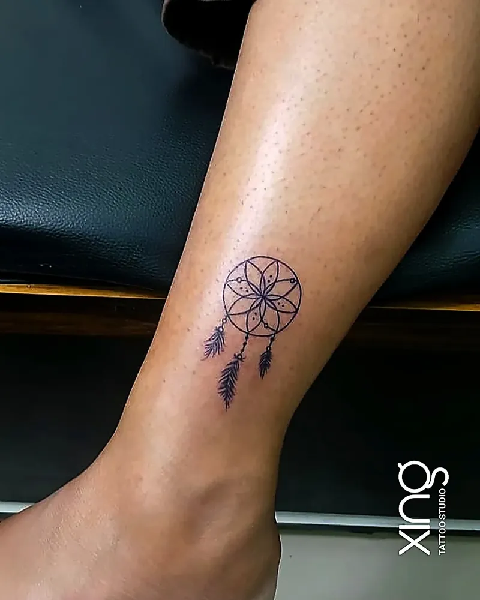

Most people imagine a tattoo starts when the machine turns on. It doesn't. The most important part of your tattoo happens before that — at the tattoo consultation, where an idea in your head becomes a design that fits your body, your skin and your life.

This guide walks through exactly what happens at a consultation: how size and placement are decided, why a skin check matters, how Peace turns your references into a stencil, and how time and price are agreed. At Xing Premium Tattoo Studio in Brookefield, consultations are free and no-pressure — and this is what you can expect.

## What is a tattoo consultation?

A tattoo consultation is a conversation with your artist before any tattooing. Together you agree what the tattoo will be, where it goes, how big it is, how long it takes and what it costs.

A good consultation answers five questions:

1. **What** — the idea, and why it matters to you.
2. **Where** — the placement on your body.
3. **How big** — a size that will still look good in years.
4. **How long** — the time and number of sessions.
5. **How much** — a clear quote.

## Why does a tattoo consultation matter?

Because it prevents the most common tattoo regrets: wrong size, wrong placement, misspelt words, designs that blur, and surprise costs. Most of those problems are decided before the needle, not during.

| Without a consultation | With a consultation |
| --- | --- |
| Size chosen from a screenshot | Size planned for your body and how ink ages |
| Placement chosen on impulse | Placement discussed for visibility, pain and work |
| Spelling unchecked | Exact text confirmed |
| Skin issues discovered on the day | Scars, moles and old ink checked first |
| Unclear price | Clear quote before you commit |

## How is the size decided?

Size is decided for how the tattoo will look in ten years, not just on day one. Ink settles slightly over time, so details need enough room to stay crisp.

What affects sizing:

- **Detail level** — more detail needs more space.
- **Text** — letters need spacing to stay readable.
- **Placement** — a wrist and a back need very different proportions.
- **Style** — fine-line, realism and geometric each have their own size rules.

If a design is too small for its detail, Peace will say so and suggest a better size or a simpler version. Our [fine line tattoo guide](/blog/fine-line-tattoos) explains these size rules for delicate work.

## What happens during the skin check?

The artist looks at the placement for anything that affects the tattoo: scars, moles, birthmarks, stretch marks, old tattoos, sensitive areas and how your skin tends to heal.

Things that are checked:

- **Scars and keloids** — some scars can be tattooed around or over; raised scars need care.
- **Moles** — usually tattooed around, not over.
- **Old tattoos** — for cover-up or rework planning.
- **Skin tone** — how contrast and colours will read. See our guide to [tattoos on Indian skin](/blog/tattoos-on-indian-skin).
- **Sensitive skin or allergies** — so the plan can adapt.

Tell your artist about any medical conditions or medication, especially blood thinners, and check with your doctor if you're unsure.

## How is the placement chosen?

Placement is chosen for how the design fits the body, how visible you want it, how much it may hurt and how it will age. The same design can look completely different on a forearm and on ribs.

Questions Peace will ask:

- Do you want to see it yourself every day?
- Do you need to cover it for work or family?
- How do you feel about pain in this area?
- Does the shape of the design suit the shape of the placement?
- Are you planning more tattoos nearby?

Our [tattoo pain chart](/blog/tattoo-pain-chart) shows how placement affects comfort.

## How does Peace turn an idea into a stencil?

Your references and story become a custom sketch, the sketch is refined with you, and the final design is turned into a stencil that's placed and checked on your skin before the needle starts.

**From idea to stencil:**

1. **Listen** — your idea, references and the story behind them.
2. **Sketch direction** — the composition, style and size are agreed.
3. **Custom drawing** — the design is drawn from scratch to fit your placement.
4. **Review** — you check it and request changes to size, detail or spelling.
5. **Stencil** — the approved design is transferred to a stencil.
6. **Placement check** — the stencil goes on your skin; you check it in the mirror, standing and moving naturally.
7. **Adjust if needed** — the stencil can be moved or resized before tattooing.

Our guide on [how to approve your tattoo sketch](/blog/approve-tattoo-sketch-stencil) explains how to review the design properly.

> **Peace's tip:** Bring the reason, not just the reference. A screenshot tells me what you like; the story tells me what to draw. The best tattoos come from both.

## How are time and price agreed?

At the end of the consultation, you get an estimate of how long the session or sessions will take and a clear quote. There's nothing to pay until you decide to go ahead.

What decides time and price:

- Size and detail.
- Style — realism takes longer than fine line.
- Placement — some areas need slower work.
- Number of sessions.

As a rough guide, small minimalist pieces take about 30 minutes to 1.5 hours, geometric and traditional work usually 1.5–4 hours, and realism or portraits 3–7 hours per sitting. Our guide to [tattoo cost in Bengaluru](/blog/tattoo-cost-in-bangalore) explains how quotes are built.

## What should I bring to my tattoo consultation?

Bring reference images, an idea of placement and size, any exact text, and photo ID. A budget helps too, if you have one.

**Consultation checklist:**

- [ ] Two to five reference images.
- [ ] Notes on what you like about each.
- [ ] The placement you're thinking about.
- [ ] A rough size — in centimetres or compared to your palm.
- [ ] The exact spelling of any names, dates or words.
- [ ] Photos of any existing tattoos nearby.
- [ ] Photo ID showing you're 18 or older.
- [ ] Your questions, written down.

## Can I have a consultation on WhatsApp?

Yes. Send your idea, placement and a rough size to {{phone}}. For detailed work, a short in-person visit helps check your skin and measure the placement.

WhatsApp works especially well for people working in Whitefield, ITPL or Marathahalli who want to start the conversation during the day. See our guide for [visiting from ITPL Main Road](/blog/tattoo-studio-near-itpl-main-road).

## What if I'm not sure what I want yet?

That's fine. Many people come to a consultation with a feeling, not a design. Bring whatever you have — a word, a memory, a style you like — and work it out together.

Helpful starting points:

- A person, place or moment you want to remember.
- A style you keep saving on Instagram.
- A placement you're drawn to.
- A symbol from your culture or faith.

Our [first tattoo guide for Bengaluru](/blog/first-tattoo-guide-bangalore) has more ideas for first-timers.

## What questions should I ask at the consultation?

Ask about the artist, the process and aftercare, so there are no surprises later:

- Who will do my tattoo?
- Can I see healed work in this style?
- How many sessions will it need?
- Is a touch-up included if part of it heals unevenly?
- How do I contact you if I have a question while healing?

## How we do it at Xing

At Xing, every consultation is free, no-pressure and with Peace himself — the same artist who will tattoo you.

1. **Visit or message** — at {{address}}, or on WhatsApp.
2. **Talk it through** — idea, story, placement, size and skin check.
3. **Get a clear quote** — time and price before you commit.
4. **Custom design** — drawn from scratch; you review and request changes.
5. **Book when ready** — no pressure to decide on the day.

Every session uses single-use needles opened in front of you and sealed, skin-tested inks. Browse our [tattoo services](/services), or read more about Peace on the [tattoo artist page](/tattoo-artist).

## Conclusion: the best tattoos start with a conversation

A tattoo consultation is where good tattoos are made: the size is right, the placement suits you, the skin is checked, the spelling is correct and the price is clear. It costs nothing at Xing, and it's the single best thing you can do for a tattoo you'll love for life.

Hours: {{hours}}. For more quick answers, visit our [FAQ page](/faq).

Ready to talk about your idea? Book a free consultation at Xing {{landmark}} — or [WhatsApp us]({{whatsapp}}).
