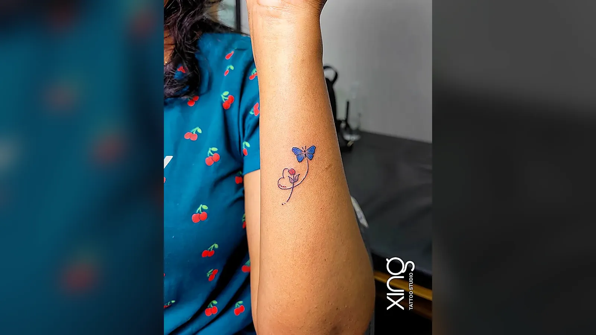

Tattoos heal in clear stages. First comes oozing and tenderness, then peeling and itching, then a cloudy "milky" phase before the ink settles and looks sharp. Knowing these tattoo healing stages helps you relax about what's normal — and spot the signs that aren't.

Every client who leaves our studio in Brookefield, Bengaluru, asks at some point, "Is this normal?" This guide answers that, stage by stage.

## Why tattoos heal in stages

A tattoo is thousands of tiny punctures in the top layers of your skin. Your body repairs them the same way it heals a scrape or a mild burn:

1. It stops bleeding and sends fluid to the area.
2. It forms a protective layer and starts building new skin.
3. Old, damaged skin peels away.
4. New skin settles over the ink.

Each stage looks and feels different. That's healing doing its job.

## Stage 1: oozing and tenderness (days 1–3)

**What you'll notice:**

- Clear fluid (plasma), a little blood and some excess ink.
- Redness close to the tattoo.
- Mild swelling and warmth.
- Tenderness, like a mild sunburn.

**What to do:**

- Keep the wrap on for as long as your artist advises.
- Wash gently with lukewarm water and mild, fragrance-free soap.
- Pat dry with a clean paper towel.
- Apply a thin layer of the aftercare product your artist recommends.
- Wear loose, clean clothing.

## Stage 2: peeling and itching (days 4–14)

This is the stage most people find hardest.

**What you'll notice:**

- Tattoo peeling — flakes of coloured skin coming off.
- Light scabbing, especially on shaded areas.
- An itchy tattoo, sometimes very itchy.
- Tightness or dryness.

**What to do:**

- Keep washing and moisturising lightly.
- Let flakes fall off naturally in the shower.
- Tap or pat gently if it itches.
- Keep your nails short.
- Wear loose clothing that won't rub.

**What not to do:**

- Don't pick, peel or scratch.
- Don't soak the tattoo in water.
- Don't use scented lotions or home remedies.

The coloured flakes are dead skin, not ink falling out. The ink stays in the deeper layer.

> **Peace's tip:** If the itching keeps you up at night, wear a soft cotton sleeve or loose top to bed so you don't scratch in your sleep. Some clients find a cool compress before bed helps them settle.

## Stage 3: cloudy skin (weeks 2–4)

Once the peeling is mostly over, the tattoo may look dull, shiny or slightly faded. This is often called the "milky" stage.

**What's happening:** a thin layer of new skin has formed over the ink. It's not fully clear yet, so it softens how the tattoo looks.

**What to do:**

- Keep moisturising once or twice a day.
- Keep it out of direct sun.
- Be patient — the tattoo usually clears as the new skin settles.

This is not the time to judge your tattoo. Wait until after a month to see its true look.

## Tattoo healing stages: full timeline

| Stage | Timing | Looks like | Feels like |
| --- | --- | --- | --- |
| Fresh | Days 1–3 | Red, shiny, oozing | Tender, warm |
| Drying | Days 3–6 | Tight, light scabs | Sore, stiff |
| Peeling | Days 4–14 | Flaky, patchy | Itchy |
| Cloudy | Weeks 2–4 | Dull, milky | Mostly comfortable |
| Settled | After about a month | Clear, final look | Normal |

Surface healing usually takes two to four weeks. Deeper layers keep settling for a while longer. Large pieces, heavily shaded tattoos and tattoos on hands, feet or joints may take longer.

## Don'ts during healing

- **Don't scratch or pick** — this is the number one cause of patchy healing.
- **Don't swim** in pools, lakes or the sea for at least two weeks.
- **Don't soak** in baths or buckets.
- **Don't sunbathe** or expose the tattoo to strong sun.
- **Don't over-moisturise** — a thin layer is enough.
- **Don't wear tight clothing** over the tattoo.
- **Don't let pets lick** or sleep on the area.
- **Don't apply sunscreen** until the tattoo is fully healed.

## Normal vs not normal

| Normal | See a doctor promptly |
| --- | --- |
| Redness close to the lines in the first few days | Redness that spreads or worsens after day three |
| Mild swelling | Swelling that increases |
| Clear fluid on day one | Pus, yellow-green discharge or a bad smell |
| Tenderness that eases | Pain that gets worse |
| Itching during peeling | Rash, hives or bumps spreading beyond the tattoo |
| Warmth on day one | Fever, chills or feeling unwell |

If you're unsure, message your studio — but if you have any of the warning signs, see a doctor first. Our guide to [infected tattoo signs](/blog/infected-tattoo-signs) explains these in more detail.

## Healing in Bangalore's weather

Sweat in summer and humidity in the monsoon can slow drying and make healing tattoos feel sticky. Our guide to [getting a tattoo in Bengaluru's weather](/blog/tattoo-bangalore-weather) has season-by-season tips.

## When to think about a touch-up

After your tattoo has fully healed — usually after a month or so — look at it in daylight. If any areas look lighter or patchy, contact your studio. Our guide to [tattoo touch-ups and rework](/blog/tattoo-touch-up-rework) explains what to expect.

## Healing different tattoo styles

- **Fine line** heals quickly but can lose ink if picked.
- **Heavy shading and realism** may scab more and take a little longer.
- **Colour** can look patchy during peeling and clear up later.
- **Large pieces** may feel sore and tired for several days.

Our full [tattoo aftercare guide](/blog/tattoo-aftercare-guide) walks you through each day.

## Healing at different placements

Where your tattoo is affects how it heals.

- **Hands and fingers** — washed often, so they may heal unevenly and fade faster.
- **Feet and ankles** — swelling can last longer; keep the area raised and avoid tight shoes.
- **Joints (elbow, knee, inner wrist)** — constant movement can slow healing.
- **Back** — hard to reach; ask someone to help with washing and moisturising.
- **Ribs and chest** — clothing and bra straps can rub.

## Signs your tattoo has fully healed

- No scabs, flakes or peeling.
- No shiny or raw patches.
- The skin feels smooth and normal to the touch.
- The colours and lines look clear in daylight.
- No tenderness when you press gently.

Once you see all of these, you can return to swimming and start using sunscreen on the tattoo.

## How we do it at Xing

At Xing, Peace explains every healing stage before you leave, so nothing comes as a surprise. You get clear aftercare guidance, and you can message us on WhatsApp with photos if you're unsure whether something is normal.

Needles are single-use and opened in front of you, inks are sealed and skin-tested, and we offer a free touch-up if any part of your tattoo heals unevenly.

## Conclusion

Tattoo healing stages follow a predictable path: oozing, peeling and itching, a cloudy phase, then the final settled look. Be gentle, be patient, don't pick, and watch for warning signs.

If you have questions about healing and you're near Brookefield, AECS Layout or Whitefield in Bengaluru, we're happy to help. You can also read our [FAQ page](/faq).

Ready to talk about your idea? Book a free consultation at Xing {{landmark}} — or [WhatsApp us]({{whatsapp}}).
