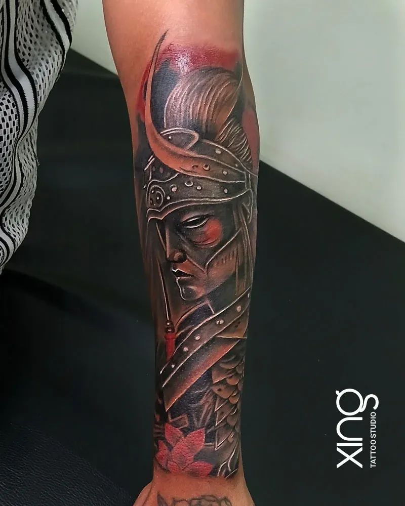

The most popular tattoos for men are bold and meaningful: realistic animals, deity portraits, family tributes, black and grey sleeves, chest pieces, lettering and geometric designs. Strong contrast and smart placement on the forearm, upper arm, chest or back help them look sharp for years.

At our studio in Brookefield, Bengaluru, men come in for everything from a small first tattoo to full sleeves and back pieces. Here are male tattoo designs and placement ideas to help you plan.

## Realism and portraits

Realism is one of the most requested styles among men.

**Popular realism ideas:**

- **Lion** — strength, courage and leadership.
- **Tiger** — power and protection.
- **Wolf** — loyalty and family.
- **Eagle** — freedom and vision.
- **Elephant** — wisdom and strength.
- **Clock or compass** — time and direction.
- **Warrior or samurai** — discipline and honour.

**Portrait tattoos** of parents, children, partners or pets are powerful tributes. Our guide to [portrait tattoo reference photos](/blog/portrait-tattoo-reference-photo) explains how to choose the right photo.

## Sleeves and chest pieces

Large pieces let a design tell a full story.

**Sleeve ideas:**

- Wildlife and forest themes.
- Spiritual sleeves with Shiva, Om, temples and mandalas.
- Warrior and mythology themes.
- Ocean, compass and travel themes.
- Family tributes with portraits, names and dates.

**Chest ideas:**

- A lion or eagle across the chest.
- A deity face over the sternum.
- Wings spreading from the centre.
- A portrait over the heart.

Our guides to [sleeve tattoo planning](/blog/sleeve-tattoo-planning) and [chest and back tattoos](/blog/chest-back-tattoo-ideas) cover large projects.

## Black and grey

Black and grey is the backbone of many bold tattoos for men. It gives depth, drama and a timeless look, and it ages well on Indian skin tones.

- Smooth shading for realism.
- Deep blacks for contrast.
- Optional colour accents — a red detail, blue eyes.

Our guide to [black and grey vs colour tattoos](/blog/black-grey-vs-colour-tattoos) explains how each style ages.

## Spiritual and Indian traditional

Spiritual designs are hugely popular among men in India.

- **Lord Shiva** — portraits, third eye, trishul and damru.
- **Hanuman** — devotion, strength and protection.
- **Ganesha** — new beginnings.
- **Om** — the sacred sound.
- **Trishul** — power and balance.
- **Mantras** — in Sanskrit or Devanagari script.

Our guide to [Indian traditional tattoos](/blog/indian-traditional-tattoos) explains meanings and respectful placement.

> **Peace's tip:** For bold designs, I always plan the darkest areas first. Deep blacks give the tattoo its punch and keep it readable from a distance — which is how most people will see it.

## Geometric

Geometric tattoos for men are clean, sharp and modern.

- Geometric animals — wolves, lions and stags built from shapes.
- Sacred geometry and mandalas.
- Bands around the forearm or calf.
- Mountain ranges inside geometric frames.
- Dotwork patterns.

## Lettering and words

- A surname across the upper back or chest.
- A motto on the forearm.
- A child's name with a date.
- "Veni vidi vici", "Patience" or another personal motto.
- A mantra along the spine or forearm.

## Placement guide: tattoos for men

| Placement | Best for | Pain |
| --- | --- | --- |
| Outer forearm | Realism, bold lettering | Low–medium |
| Inner forearm | Words, dates | Medium |
| Upper arm / shoulder | Portraits, animals, spiritual | Low |
| Chest | Large realism, deities, wings | Medium–high |
| Upper back | Wings, surnames, deities | Low–medium |
| Full back | Large scenes | Varies |
| Calf | Animals, geometric | Low–medium |
| Hands and fingers | Small symbols | High, fades faster |

Our [tattoo pain chart](/blog/tattoo-pain-chart) compares every spot.

## Tattoos and fitness

Many men who train regularly ask how muscle growth affects tattoos.

- **Moderate muscle gain** usually doesn't distort a well-placed tattoo.
- **Significant changes** in size can stretch designs on the upper arm, chest and shoulders.
- **Plan placement** with your fitness goals in mind.
- **Skip the gym** for about two weeks after a new tattoo to avoid sweat, friction and stretching.

## Tattoos and work

In many Bengaluru workplaces — especially tech and creative roles — tattoos are widely accepted. Some client-facing, government and uniformed roles have stricter rules. If you're unsure, start with the upper arm, chest or back, which are easy to cover.

## First tattoos for men

If this is your first tattoo, start with something meaningful that you can build on:

- A small lion, wolf or eagle on the outer forearm or upper arm.
- A trishul or Om on the forearm.
- A child's name and birth date on the inner forearm.
- A compass or clock on the upper arm.
- A geometric band around the forearm.

Choose a placement with room to grow if you think you'll add more later. Our [first tattoo guide for Bengaluru](/blog/first-tattoo-guide-bangalore) covers everything else first-timers need.

## Common mistakes to avoid

- **Choosing a design only because it's trending** — trends change; your tattoo won't.
- **Going too small** with a detailed animal or portrait.
- **Skipping the consultation** and picking a design from the internet.
- **Not planning a sleeve** before starting the first piece.
- **Hitting the gym too soon** after a new tattoo.
- **Ignoring sun protection** on outer forearm tattoos.

## Matching tattoos with family

Many men choose tattoos with their fathers, brothers or sons — the same symbol, a shared surname, or a tribute to a parent. Book together so the designs are consistent, and choose placements that suit each person's work and lifestyle.

## Tattoo styles at a glance

| Style | Look | Best placements |
| --- | --- | --- |
| Realism | Photo-like depth and texture | Forearm, upper arm, chest, back |
| Black and grey | Classic, dramatic shading | Anywhere |
| Spiritual | Deities, Om, trishul, mantras | Forearm, chest, upper back |
| Geometric | Sharp lines, symmetry | Forearm, calf, back |
| Lettering | Words, names, mottos | Forearm, chest, upper back |
| Minimal | Small symbols | Wrist, forearm, behind the ear |

Mixing styles in one piece can work beautifully when one style leads — for example, a realistic lion framed by geometric lines.

## Caring for bold tattoos long-term

Bold tattoos with deep blacks last well, but a little care keeps them striking. Use sunscreen on exposed tattoos every day, moisturise regularly, and stay hydrated. If highlights soften after many years, a touch-up can bring back the contrast. Our guide to [tattoo touch-ups and rework](/blog/tattoo-touch-up-rework) explains when a refresh helps.

## How we do it at Xing

At Xing, Peace specialises in bold black and grey work, realism and spiritual designs, all drawn from scratch and planned for your body. Large pieces are mapped and split into sessions with healing time between.

Needles are single-use and opened in front of you, inks are sealed and skin-tested, and the workstation is re-wrapped between every client. See our [realism tattoo work](/services/realism).

## Conclusion

Tattoos for men can be bold, meaningful and built to last. Realism, portraits, black and grey sleeves, chest pieces, spiritual designs and geometric work all look powerful when they're planned with strong contrast and the right placement.

If you're planning a bold tattoo in Bengaluru — from Brookefield and AECS Layout to Whitefield — bring your idea for a free consultation. Browse our [tattoo gallery](/#gallery) for real work.

Ready to talk about your idea? Book a free consultation at Xing {{landmark}} — or [WhatsApp us]({{whatsapp}}).
