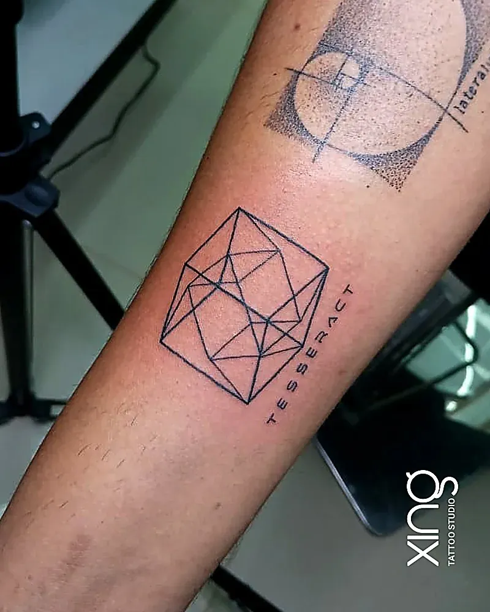

If your workday starts and ends on ITPL Main Road, you already know how precious evenings are. The good news: finding a tattoo studio near ITPL doesn't mean losing a whole weekend to travel. Xing is {{landmark}}, on 60 Feet Road, and easy to reach after work.

This guide is for techies who want convenient ink: quick consultations around work hours, design ideas that suit people who think in patterns and logic, and aftercare that fits a desk job.

## Is there a tattoo studio near ITPL I can visit after work?

Yes. Xing is at {{address}} — easy to reach from ITPL and Whitefield.

**Hours:** {{hours}}.

That evening window is what makes it work for most ITPL clients. You can leave the office, reach the studio and still have time for a relaxed consultation or a small session.

**Travel tips from ITPL:**

- Check live traffic in Google Maps before you leave.
- Give your cab or auto "DMART Ready, 60 Feet Road, AECS Layout" as the drop point.
- On a two-wheeler, carry a light long sleeve to cover a fresh arm tattoo on the ride back.

## How do WhatsApp consultations work around work hours?

You send your idea, placement and a rough size on WhatsApp, and we reply with questions and next steps. Then you visit for a short in-person check when it suits you.

What to send on WhatsApp:

1. **Reference images** — screenshots are fine.
2. **Placement** — a photo of the area helps.
3. **Approximate size** — in centimetres or "palm-sized".
4. **Visibility** — do you need it covered at work?
5. **Your timeline** — any releases, travel or events coming up?

The consultation is free and there's no obligation. If you'd like to know what happens next, read [why a tattoo consultation matters](/blog/tattoo-consultation-what-happens).

## What tattoo ideas suit techies?

Geometric, sacred geometry, minimalist symbols and small code-inspired pieces suit people who love logic and structure. The key is keeping them clean and big enough to stay sharp.

**Popular directions:**

| Idea | Why techies like it | Size and placement tip |
| --- | --- | --- |
| Golden ratio spiral | Maths meets design | Forearm, palm-sized or bigger |
| Tesseract or cube | 3D thinking in 2D lines | Forearm or calf |
| Binary or hex of a date | Hidden meaning | Keep it short; inner forearm |
| Circuit-style linework | Clean, modular look | Works as a band or panel |
| Sci-fi symbols | Fandom, personal story | Upper arm, calf |
| Brackets or a short keyword | Minimal and clever | Wrist or ankle, simple font |

Our [geometric and mandala tattoo guide](/blog/geometric-mandala-tattoos) explains how symmetry is mapped to the body, and our new post on [cyberpunk and neo-tribal tattoos](/blog/cyberpunk-neo-tribal-tattoos-bangalore) explores bolder, digital-inspired styles.

## Can I get a code or binary tattoo that stays readable?

Yes, if you keep it short and size it properly. Tiny, dense characters can blur together as skin ages, so fewer characters at a larger size always beats a long line squeezed small.

**Rules that keep code tattoos sharp:**

- **Shorter is better.** A meaningful keyword or a short snippet ages far better than a full function.
- **Use a clean, monospace-style font** with open letter shapes.
- **Leave space between characters** — ink spreads very slightly over the years.
- **Double-check syntax and spelling.** Peace will confirm the exact text with you before stencilling.
- **Choose a flat, stable area** like the inner or outer forearm.

> **Peace's tip:** If your idea is a long string of code, let's find the one line that carries the meaning. A short, well-spaced snippet looks deliberate and stays readable for years.

For more on lettering, see our guide to [script and calligraphy tattoo fonts](/blog/script-calligraphy-tattoo-fonts).

## Why do geometric tattoos need a skilled hand?

Geometric tattoos show every wobble. Straight lines, even spacing and true symmetry are unforgiving, so stencil placement and steady line work matter more than in almost any other style.

What makes geometric work succeed:

- **Stencils mapped to your body's curve**, so lines look straight when your arm is relaxed.
- **Consistent line weight** across the whole design.
- **Measured spacing** in dotwork and patterns.
- **Enough size** for small shapes to stay distinct.

You can see examples on our [geometric tattoo service page](/services/geometric).

## What is low-maintenance tattoo aftercare for a desk job?

Wash gently twice a day, pat dry, apply a thin layer of aftercare product, wear loose sleeves, and don't pick or scratch. That's genuinely most of it.

**Your desk-job routine:**

- **Morning:** wash, pat dry, thin layer of product, loose shirt.
- **At work:** don't rest a fresh forearm tattoo on the desk edge or laptop.
- **Evening:** wash again after the commute dust.
- **Night:** clean sheets, avoid sleeping on the tattoo.

**Avoid for the first couple of weeks:**

- Swimming, saunas and long soaks.
- Direct sun on the tattoo.
- Tight watches or fitness bands over the area.
- Scented lotions.

Our [tattoo aftercare guide](/blog/tattoo-aftercare-guide) has the full day-by-day timeline. If you also hit the gym after work, read [can I work out after getting a tattoo](/blog/workout-after-tattoo).

## Who will design and do my tattoo?

Peace, the studio's lead artist, handles every consultation, design and session. He has {{years}} years of experience and {{tattoos}} tattoos completed.

That means no handoffs. The person who hears your idea is the person who draws and tattoos it. Read more on the [tattoo artist page](/tattoo-artist).

## Which placements work best for techies?

The outer forearm, upper arm, calf and back are the most practical: comfortable to tattoo, easy to care for at a desk, and simple to cover if you need to.

**A quick placement guide for desk jobs:**

- **Outer forearm** — great for geometric and symbol work; visible when you want it, covered by full sleeves.
- **Inner forearm** — perfect for short text or code; avoid resting it on the desk while healing.
- **Upper arm and shoulder** — hidden under a T-shirt, ideal if you're client-facing.
- **Calf** — a large, flat canvas for geometric panels; just avoid tight socks while healing.
- **Back** — the biggest canvas for sacred geometry; needs help with aftercare.
- **Wrist** — tiny symbols only; watches and bands can rub, so plan for a couple of weeks without them.

Hands and fingers are popular on social media, but they fade faster because the skin there renews quickly and gets heavy use. If you type all day, think carefully before choosing them.

### Think about the long term

A placement that suits your current company may not suit your next role or a client visit abroad. If you're unsure, pick a spot you can show or cover easily. Our [tattoo pain chart](/blog/tattoo-pain-chart) also helps you compare comfort across placements.

### Size up for clean lines

Geometric designs need room. If a pattern has lots of small shapes, a slightly larger size keeps each shape distinct as the years go by. Peace will measure your placement and suggest the smallest size that will still age well.

### Plan around your work calendar

Try not to book a session the week of a big release, an onsite client visit or a long flight. The first few days of healing go most smoothly when you can rest, wear loose clothes and keep to a simple cleaning routine. A Friday evening or Saturday slot, followed by a quiet Sunday, is the easiest pattern for most ITPL clients.

## How we do it at Xing

For ITPL and Whitefield clients, our process fits around a working week:

1. **WhatsApp first** during the day — idea, placement, size.
2. **Free evening consultation** — skin check, measurements, clear quote.
3. **Custom design** — drawn from scratch; you review and request changes.
4. **Session** — single-use needles opened in front of you, sealed US-imported inks, barrier film on the machine, cables, bottles and workstation.
5. **Aftercare** — written guidance, WhatsApp support, and one free touch-up within 45–60 days if anything heals unevenly.

The studio also has free Wi-Fi, which helps if you need to answer a message before or after your slot.

## Conclusion: ink that fits your workweek

A good tattoo studio near ITPL should make the process easy: quick conversations, evening hours, honest design advice and simple aftercare. Keep geometric and code ideas clean and well-sized, time your session before a weekend, and you'll barely notice the healing at work.

Have more questions? Our [FAQ page](/faq) covers booking, pain and aftercare.

Ready to talk about your idea? Book a free consultation at Xing {{landmark}} — or [WhatsApp us]({{whatsapp}}).
