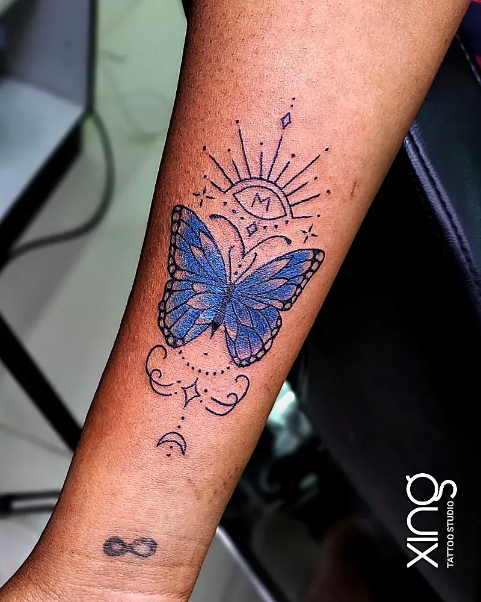

Commuting between Marathahalli and ITPL means you pass Kundalahalli Gate almost every day. So when you finally decide on a tattoo, it makes sense to look for a tattoo studio near Kundalahalli Gate — somewhere you can reach after work without a long detour.

Distance is only the start, though. This guide gives you a quick checklist to judge any studio in the area, then explains how to find Xing, {{landmark}}.

## What should I look for in a tattoo studio near Kundalahalli Gate?

Look for three things before anything else: a varied portfolio of real work, hygiene you can see, and a clear price before you commit. A good studio will happily show you all three.

Here's the short version as a checklist you can use anywhere:

- [ ] The portfolio shows **several styles** — not just one kind of tattoo.
- [ ] There are **close-up and healed photos**, not only fresh ones.
- [ ] Needles are **single-use and opened in front of you**.
- [ ] The workstation is **covered in barrier film** and re-wrapped between clients.
- [ ] Inks are **sealed** and opened for your session.
- [ ] You get a **clear quote** before you pay anything.
- [ ] The artist **explains aftercare** in plain words.
- [ ] You feel **comfortable asking questions** — no pressure to book on the spot.

If a studio fails more than one or two of these, keep looking. Our [10 checks before you book in Brookefield](/blog/best-tattoo-studio-brookefield) goes deeper on each point.

## Why does portfolio variety matter?

Variety shows an artist can adapt — to your idea, your skin and your placement. A studio that only posts one style may struggle with anything outside it.

When you scroll through a portfolio, look for:

- **Line work** — are fine lines clean and even, or wobbly?
- **Shading** — are greys smooth, or patchy?
- **Different placements** — forearm, ribs, back, hand, neck.
- **Different skin tones** — especially Indian skin tones, since contrast behaves differently. Our guide to [tattoos on Indian skin](/blog/tattoos-on-indian-skin) explains why.
- **Healed results** — how the tattoo looks weeks or months later.

At Xing, Peace works across realism, portraits, black and grey, fine-line, geometric and Indian traditional designs. You can see examples of each on our [tattoo services page](/services).

## How can I tell if a tattoo studio is hygienic?

Watch the setup in front of you. Needles should be sealed and opened while you watch, surfaces should be wrapped, and the artist should wear fresh gloves.

Things you should see:

1. A clean, uncluttered workstation.
2. Barrier film on the machine, cables and bottles.
3. Sealed needles opened in front of you.
4. Fresh ink caps filled for your session only.
5. Gloves changed whenever the artist touches something outside the work area.

Things that should make you walk away:

- Needles already unwrapped when you arrive.
- Ink poured from a shared bottle back into the bottle.
- Dusty or stained surfaces.
- An artist who gets defensive when you ask about hygiene.

Our full [hygienic tattoo studio checklist](/blog/hygienic-tattoo-studio-checklist) explains what each step protects you from.

## How much does a tattoo near Kundalahalli cost?

There's no single price — it depends on size, detail, style, placement and how long the session takes. A good studio gives you a clear quote at the consultation, not a vague range over the phone.

What should be included in a fair quote:

| Quote item | What to ask |
| --- | --- |
| Design | Is the custom drawing included? |
| Size and placement | Is the quote for the size we agreed? |
| Session time | How long will it take, roughly? |
| Touch-up | Is there a free touch-up if something heals unevenly? |
| Aftercare | Will I get written or WhatsApp guidance? |

Be wary of prices that seem too good to be true. Cheap tattoos often cost more later in cover-ups and fixes. Our guide to [tattoo cost in Bengaluru](/blog/tattoo-cost-in-bangalore) explains the seven factors that decide a quote.

## Why does a relaxed studio vibe matter?

A calm studio makes for a better tattoo. When you're relaxed, you sit still more easily, ask the questions you actually have, and take breaks when you need them.

A good vibe looks like:

- The artist listens before sketching.
- You're never rushed into deciding on the day.
- Breaks are normal, not an inconvenience.
- Music and conversation are easy-going.
- First-timers get things explained step by step.

> **Peace's tip:** If you're nervous, tell me at the start. I'll walk you through every step before the machine even turns on, and we'll take breaks whenever you want. A relaxed client makes my lines cleaner, too.

## How do I get to Xing from Kundalahalli Gate?

Head for AECS Layout and 60 Feet Road, then look for DMART Ready. Xing is {{landmark}}.

A few practical tips for commuters:

- **Search "Xing Brookefield"** in Google Maps for live directions.
- **Evening traffic** on the Marathahalli–ITPL stretch can be heavy, so leave a little buffer before your slot.
- **Two-wheeler riders**: if you're coming for a session, carry a light, loose long sleeve to cover a fresh arm tattoo on the ride home.
- **Cab or auto**: "DMART Ready, 60 Feet Road, AECS Layout" is the easiest drop point to give.

The full address is {{address}}. Phone and WhatsApp: {{phone}}.

## When is the best time to visit?

Weekday evenings and weekends suit most Kundalahalli and ITPL commuters. Studio hours: {{hours}}.

Some simple planning ideas:

- **Consultation:** a weekday evening after work.
- **Small fine-line piece:** can sometimes fit into an evening.
- **Larger piece:** book a weekend slot so you have time to rest afterwards.
- **Sleeve or back piece:** plan sessions a few weeks apart for healing. Our [sleeve tattoo planning guide](/blog/sleeve-tattoo-planning) explains the pacing.

## What if I've never had a tattoo before?

That's completely fine — many of our clients from around Kundalahalli are first-timers. Start with a free consultation and a small, simple design.

Good first-tattoo habits:

- Pick a placement that's easy to care for, like the outer forearm.
- Eat a proper meal and drink water before your session.
- Avoid alcohol for 24 hours beforehand.
- Bring photo ID — you must be 18 or older.

Our [first tattoo guide for Bengaluru](/blog/first-tattoo-guide-bangalore) covers everything step by step.

## What questions should I ask on my first visit?

Ask about the artist, the process and the aftercare. A good studio answers all of these clearly and without getting defensive.

Questions worth asking at any studio near Kundalahalli:

1. **Who will do my tattoo?** Is it the same person I'm talking to now?
2. **Can I see healed work** in a similar style and placement?
3. **Is the design drawn for me**, or adapted from flash?
4. **Will I see the sketch** and be able to request changes before booking?
5. **How long will the session take**, and will I need more than one?
6. **What does the quote include** — design, session and touch-up?
7. **How do I contact you** if something looks wrong while healing?

Write your questions down before you go. It's easy to forget them once you're looking at designs. At Xing, Peace is the only person you'll deal with — from the first question to the final touch-up.

### Red flags that should make you pause

- The price changes a lot once you've sat down.
- Nobody can tell you which artist will do the work.
- You're pushed to book and pay a deposit on the spot.
- Healed photos are "not available".
- Aftercare advice is a one-line "just put cream on it".

Trust your instincts. If something feels rushed or unclear, it's fine to say thank you and leave.

## How we do it at Xing

For commuters coming from Kundalahalli Gate, Marathahalli or ITPL, we keep things simple:

1. **WhatsApp first** — send your idea, placement and rough size during the day.
2. **Free evening consultation** — meet Peace, talk it through, get a clear quote.
3. **Custom sketch** — drawn from scratch; you request changes before booking.
4. **Session** — single-use needles opened in front of you, sealed US-imported inks, barrier-wrapped station.
5. **Aftercare** — clear guidance, WhatsApp support, and one free touch-up within 45–60 days if anything heals unevenly.

Every design and session is handled by Peace personally — you can read about his experience on the [tattoo artist page](/tattoo-artist).

## Conclusion: close is good, right is better

A tattoo studio near Kundalahalli Gate saves you time, but the checklist matters more than the distance. Look for real variety, visible hygiene, an honest quote and a studio where you feel at ease.

If that sounds like what you want, Xing is just off your daily route, {{landmark}}. Read our [FAQ page](/faq) for more quick answers.

Ready to talk about your idea? Book a free consultation at Xing {{landmark}} — or [WhatsApp us]({{whatsapp}}).
