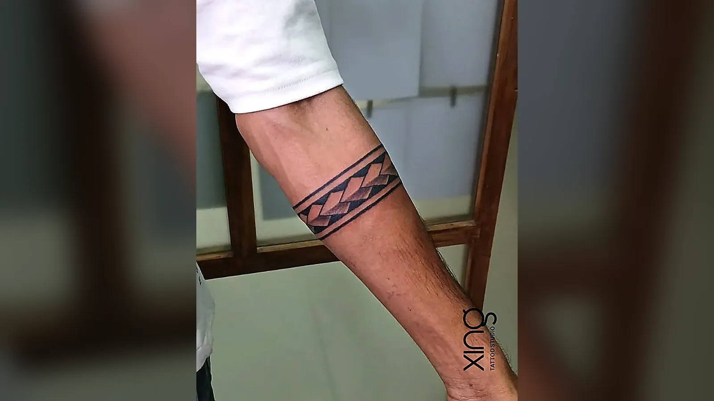

A tattoo touch up refreshes the parts of a tattoo that have faded, healed unevenly or softened with age. It's quick, usually small and can make an older tattoo look sharp again. When a tattoo needs more than a refresh, a rework or full restoration can improve the whole design.

Every tattoo changes over time. That's normal — skin renews itself, the sun breaks down ink and some areas rub against clothes every day. Knowing when and how to refresh a tattoo keeps it looking its best for decades.

Here's how we explain the options to clients at our studio in Brookefield, Bengaluru.

## Why tattoos fade

A faded tattoo isn't always a sign of bad work. Several things affect how ink holds up:

- **Sun exposure.** UV light is the biggest cause of fading, especially on arms, hands and the back of the neck.
- **Skin renewal.** Your skin constantly sheds and rebuilds, and ink particles slowly move and spread.
- **Friction.** Tattoos on hands, feet, fingers, ankles and under straps rub every day.
- **Placement.** Areas that stretch, sweat or are washed often — like wrists and hands — fade faster.
- **Healing.** Picking scabs, soaking a fresh tattoo or getting sun on it while healing can pull out ink early.
- **Technique.** Ink placed too shallow can heal patchy; ink placed too deep can blur.
- **Ink colour.** Light colours like yellow, pastel shades and white soften faster than black.

Understanding the cause helps decide the fix.

## Touch-up vs rework vs restoration

These three words are often used interchangeably, but they mean different things.

| Option | What it does | Best for | Typical time |
| --- | --- | --- | --- |
| Touch-up | Fills small patchy or light areas | Recently healed tattoos with uneven spots | Short session |
| Rework | Improves the design — adds shading, strengthens lines, fixes lettering | Tattoos you like but that look weak or flat | One or more sessions |
| Restoration | Revives an old, faded tattoo close to its original look | Older pieces that have softened over years | One or more sessions |

**A touch-up** is the simplest. If a few spots healed lighter than the rest, the artist fills them in so the tattoo looks even.

**A rework** changes the tattoo more. It might add shading to a flat outline, darken lines, extend the design or fix uneven script.

**A restoration** brings back the original look of a faded tattoo — darkening lines, refreshing colour and rebuilding contrast.

## Timing after healing

Always wait until a tattoo is completely healed before a touch-up.

**General timeline:**

- **Small tattoos:** usually four to six weeks after the session.
- **Large or heavily shaded pieces:** six weeks or more.
- **Older tattoos for rework or restoration:** any time, as long as the skin is healthy.

Healing has finished when there are no scabs, no shiny patches and no raw or sensitive areas. Judging a tattoo too early can be misleading — the "milky" stage around weeks two to four can make a perfectly good tattoo look faded.

> **Peace's tip:** Take a photo of your tattoo in daylight about six weeks after your session. Compare it with the fresh photo. If any area looks lighter, send both photos to your studio — it's much easier to judge with a side-by-side view.

## Blowouts: what they are and what can be done

A blowout happens when ink is pushed too deep or at the wrong angle and spreads under the skin. It looks like a blurry, bluish halo around lines.

**Blowouts can be caused by:**

- Needle depth that's too deep.
- Thin or delicate skin, such as on the wrist, ankle or inner arm.
- Stretching the skin too much during tattooing.
- Very fine lines placed close together.

**What can be done:**

- **Disguise with shading** so the blur blends into the design.
- **Bolder outlines** that cover the soft edges.
- **Rework** into a larger or darker design.
- **Laser lightening** in some cases, through a qualified dermatologist.

Blowouts can't be erased by tattooing over them, but a skilled artist can often make them far less noticeable.

## What to expect at a tattoo touch up appointment

1. **Assessment.** The artist examines the tattoo in good light and asks how it healed.
2. **Plan.** You discuss which areas need attention and whether a touch-up or rework is better.
3. **Setup.** Just like any session — single-use needles, fresh ink caps, barrier film.
4. **Touch-up.** Usually quick, focused only on the areas that need it.
5. **Aftercare.** The same routine as a new tattoo, for a shorter healing period.

Touch-ups heal like a new tattoo, so plan two weeks without swimming or long sun exposure.

## Faded tattoo checklist

Ask yourself:

- [ ] Has it been at least a month since the session?
- [ ] Are there patches lighter than the rest?
- [ ] Have the lines become soft or uneven?
- [ ] Has colour faded more than black?
- [ ] Is there any blurring around the edges?
- [ ] Do I still like the design itself?

If you still love the design, a touch-up or restoration is likely enough. If you don't, a rework or cover-up may be better. Our guide to [tattoo cover-ups](/blog/tattoo-cover-up-guide) explains that option.

## How to keep tattoos from fading

Prevention is easier than repair.

- **Sunscreen every day** on exposed tattoos once healed.
- **Moisturise regularly** to keep skin healthy.
- **Avoid picking** while healing.
- **Choose placement wisely** — fingers, palms and feet fade fastest.
- **Pick designs with enough size and contrast** to age well.
- **Follow aftercare closely** for the first month.

Our [tattoo aftercare guide](/blog/tattoo-aftercare-guide) covers every stage of healing.

## When a touch-up isn't enough

Sometimes a tattoo has changed too much for a simple refresh:

- The design has blurred so lines run together.
- The tattoo was poorly done to begin with.
- You no longer like the design.
- There are spelling mistakes or major unevenness.

In these cases, a rework, cover-up or laser lightening may be better. Our guide to [watercolour tattoos](/blog/watercolour-tattoos) explains why some colour-heavy styles soften faster, and our [hand and finger tattoo guide](/blog/hand-finger-tattoos) covers placements that fade quickly.

## How we do it at Xing

At Xing, we offer a free touch-up if any part of your tattoo heals unevenly. If you have an older tattoo — from us or elsewhere — Peace will assess it honestly and suggest whether a touch-up, rework, restoration or cover-up will give you the best result.

Every session, including touch-ups, uses single-use needles opened in front of you and sealed, skin-tested inks, and the workstation is re-wrapped between every client.

## Conclusion

A tattoo touch up is often all it takes to bring a tattoo back to life. Understand why tattoos fade, wait until healing is complete, and choose between a touch-up, rework or restoration based on how much needs to change.

If you have a faded tattoo and live around Brookefield, Whitefield or Marathahalli in Bengaluru, send us a daylight photo or come in for a free consultation. You can also see our [tattoo services](/services) or read our [FAQ](/faq).

Ready to talk about your idea? Book a free consultation at Xing {{landmark}} — or [WhatsApp us]({{whatsapp}}).
