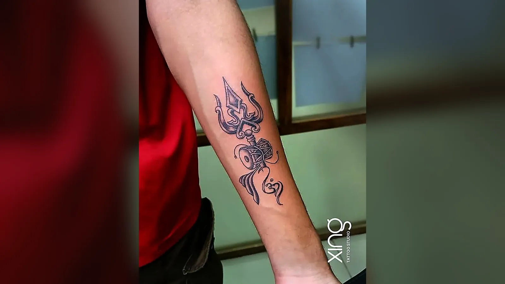

Visible tattoos at work are far more accepted in India than they used to be — especially in Bengaluru's IT and tech companies. But rules still vary by company, role and industry. Choosing a flexible placement and checking your workplace or recruitment guidelines lets you enjoy your tattoo without worrying about your career.

Many of our clients at our studio in Brookefield work in the tech parks around Whitefield, ITPL, Marathahalli and the Outer Ring Road. Tattoos at work is one of the questions we hear most.

Here's what to consider.

## Changing workplace attitudes

A generation ago, visible tattoos were often seen as unprofessional. Today, attitudes have shifted:

- Many tech, startup and creative companies are relaxed about tattoos.
- Younger teams often see tattoos as personal expression.
- Many managers and senior leaders have tattoos themselves.
- Dress codes in many offices have become more casual.

That said, every company has its own culture. What's fine at one office may not be at another.

## Client-facing vs tech roles

| Role type | Typical attitude | Things to consider |
| --- | --- | --- |
| Software, engineering, product | Often relaxed | Few restrictions in many companies |
| Design, marketing, startups | Often relaxed | Tattoos may even be part of the culture |
| Client-facing consulting, sales | Mixed | May need to cover for meetings |
| Banking, finance, law | More conservative | Often prefer covered tattoos |
| Hospitality, airlines | Varies | Uniform and grooming rules may apply |
| Healthcare | Varies | Hygiene and uniform policies |
| Government, defence, police | Often specific rules | Check official guidelines |

If your job involves meeting clients from conservative industries or traditional settings, you may want the option to cover up.

## Government and defence job rules — check official guidelines

Some government, defence, police and uniformed services in India have rules about tattoos. These rules can cover:

- Where on the body tattoos are allowed.
- What tattoos can show.
- Whether tattoos must be declared during recruitment.

**These rules can change, and they differ between services.** We can't give you a definitive list, and you shouldn't rely on general information online. Before getting tattooed, **check the latest official recruitment notice or guidelines** for the specific job or service you're interested in.

If you're planning to apply for such a role, it's wise to choose a placement that's easy to cover and to avoid visible areas like the hands, forearms, neck and face until you're sure.

## Placement for flexibility

The smartest way to balance tattoos and work is placement.

**Easy to cover with office wear:**

- Upper arm and shoulder — hidden by short or full sleeves.
- Upper and lower back.
- Chest and ribs.
- Thigh and hip.
- Ankle — under socks and trousers.
- Inner wrist — under a watch.

**Visible in most office clothing:**

- Hands and fingers.
- Neck and behind the ear (depending on hair).
- Face.

**Visible sometimes:**

- Forearms — visible in short sleeves, hidden in full sleeves.
- Calves — visible in shorts or skirts.

Our [tattoo placement guide](/blog/tattoo-placement-guide) compares every spot for visibility, pain and ageing.

> **Peace's tip:** If you're unsure about work, start with the upper arm or shoulder. You can always add a forearm piece later once you know how your workplace feels — but you can't easily hide a hand tattoo.

## Choosing designs you'll love long-term

At work, the design itself matters too.

- **Choose meaning over trends.** A design that means something to you is easier to stand behind.
- **Avoid offensive imagery** — anything violent, explicit or likely to upset colleagues or clients.
- **Think about size.** A small, tasteful tattoo rarely raises eyebrows.
- **Consider quality.** A well-done, clean tattoo always looks more professional than a rushed one.
- **Check spelling carefully** on any words.

Our guide to [wrist tattoo ideas](/blog/wrist-tattoo-ideas) covers small designs that are easy to show or hide.

## Tips for talking about tattoos at work

- **Check the dress code** before your first day or before a visible tattoo.
- **Ask HR** if you're unsure — it's a normal question.
- **Be confident.** A well-chosen tattoo is part of who you are.
- **Cover up when needed** for client meetings, interviews or formal events.
- **Respect cultural settings** — some events or sites may expect tattoos to be covered.

## Interviews and tattoos

If you're interviewing, consider covering visible tattoos until you understand the company culture. Many people choose a full-sleeve shirt for interviews and then follow the office norm once they've joined.

## Healing while working

A new tattoo needs care even on workdays:

- Wear loose sleeves or clothing over the tattoo.
- Avoid leaning on desks with a fresh forearm tattoo.
- Keep aftercare products and paper towels at work.
- Wash your hands before touching the tattoo.
- Avoid air-conditioned dryness by moisturising lightly.

Our [tattoo aftercare guide](/blog/tattoo-aftercare-guide) covers the full routine.

## Tattoos and your career: a balanced view

For most people working in Bengaluru today, a tattoo won't hold back their career. But it's still worth planning:

1. **Know your industry** and future plans.
2. **Choose flexible placements** first.
3. **Pick designs you'll be proud of** in any setting.
4. **Check official rules** if you're aiming for government, defence or uniformed roles.

## Small tattoos that work in most offices

If you'd like a visible tattoo but want to keep it subtle, consider:

- A small symbol on the inner wrist.
- A short word on the inner forearm.
- A tiny design behind the ear.
- A fine-line flower on the ankle.
- A minimal design on the upper arm that peeks out from short sleeves.

These are easy to show at casual events and easy to cover for formal meetings. Our list of [30 minimalist tattoo ideas](/blog/minimalist-tattoo-ideas) has more small designs.

## Tattoos and family expectations

For many people in India, workplace questions go hand in hand with family ones. If you're worried about both, start small and choose a placement you can cover at family functions as well as at work. A meaningful design — a tribute to a parent, a spiritual symbol, a child's name — often helps families understand why the tattoo matters to you.

## How we do it at Xing

At Xing in AECS Layout, many clients work in tech parks around Whitefield and Marathahalli. Peace often helps them choose placements that can be shown or covered easily, and designs that stay tasteful and meaningful.

The consultation is free, every design is drawn from scratch, needles are single-use and opened in front of you, and inks are sealed and skin-tested. Our hours are {{hours}} — evening slots help if you're coming after work.

## Conclusion

Tattoos at work are widely accepted in many Indian workplaces, especially in tech. Still, rules vary by role, so choose a placement you can cover when needed, pick a design you'll be proud of, and check official guidelines if you're aiming for government or uniformed jobs.

If you work around Whitefield, Marathahalli or Brookefield in Bengaluru, drop in after work for a free consultation. You can also read our [FAQ page](/faq) or browse our [tattoo services](/services).

Ready to talk about your idea? Book a free consultation at Xing {{landmark}} — or [WhatsApp us]({{whatsapp}}).
