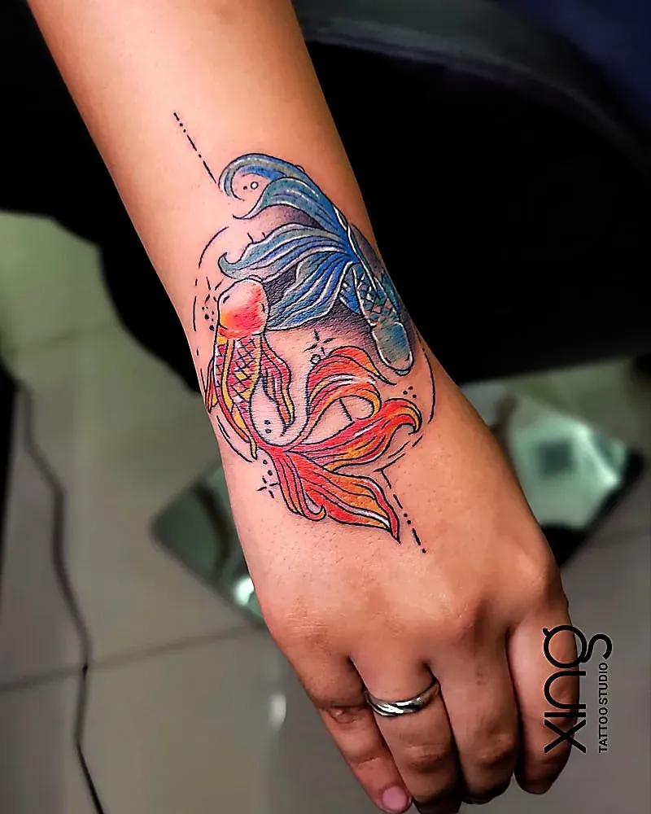

More of our clients in Bengaluru are asking the same question: is the ink vegan? And underneath that, a bigger one: are tattoo pigments actually safe for my skin? Both are good questions. The answers are a little different from what you might expect.

This guide explains what vegan tattoo ink really means, what's in "traditional" ink, how allergies and metals fit in, when a patch test makes sense, and how Bengaluru's humid climate affects healing. It also explains, honestly, what we can and can't tell you about the inks we use at Xing Premium Tattoo Studio in Brookefield.

This is general information, not medical advice. If you have allergies or a skin condition, speak to a dermatologist.

## What is vegan tattoo ink?

Vegan tattoo ink is made without animal-derived ingredients. Instead of animal products, it uses plant-based or synthetic pigments, binders and carriers.

Ingredients that make an ink non-vegan:

- **Bone char** — charred animal bone, used in some black pigments.
- **Glycerin from animal fat** — used as a carrier in some inks; plant glycerin is the vegan alternative.
- **Gelatin** — from animal tissue, used as a binder.
- **Shellac** — a resin from lac insects, used as a binder.

Many modern inks already avoid these. The only reliable way to know is to check the manufacturer's information for the specific ink.

## Is vegan tattoo ink safer than traditional ink?

Not automatically. "Vegan" tells you where the ingredients come from, not how your skin will react to them. A vegan ink can still contain a pigment you're sensitive to.

| Question | Vegan ink | Traditional ink |
| --- | --- | --- |
| Contains animal products? | No | Sometimes |
| Automatically safer? | No | No |
| Can cause allergies? | Possibly | Possibly |
| What decides safety? | Brand quality, sealed bottles, hygiene | Brand quality, sealed bottles, hygiene |
| Good choice if vegan matters to you? | Yes | Check ingredients |

If being vegan matters to you, choosing vegan ink is a valid ethical choice. Just don't treat the label as a safety guarantee.

## What actually makes tattoo ink safe?

A reputable brand, sealed bottles, skin-tested pigments, single-use ink caps and a hygienic studio. Those matter far more than the vegan label.

**Safety checklist for any studio:**

- [ ] Ink comes from a known, reputable manufacturer.
- [ ] Bottles are sealed and opened for use, not refilled.
- [ ] Ink is poured into fresh, single-use caps for your session.
- [ ] Leftover ink is thrown away, never poured back.
- [ ] Needles are single-use and opened in front of you.
- [ ] The workstation is covered in barrier film.

Our [hygienic tattoo studio checklist](/blog/hygienic-tattoo-studio-checklist) explains each of these in detail.

## Can I be allergic to tattoo ink?

Yes, though it's uncommon. Reactions are most often linked to red pigments, and sometimes to yellow, green, blue or other colours. Black reactions are less common.

Possible signs of an ink reaction:

- Persistent itching in one colour of the tattoo.
- Raised, bumpy or scaly skin in that colour.
- A rash that appears weeks, months or even years later.
- Swelling in one area of colour, sometimes triggered by sun.

**What to do:**

- Don't scratch or try home remedies.
- Message your artist with photos.
- See a doctor or dermatologist for diagnosis and treatment.

Ink reactions are different from infections. If you have spreading redness, pus, fever or worsening pain, see a doctor promptly. Our guide to [infected tattoo signs](/blog/infected-tattoo-signs) explains the difference.

## What about metals in tattoo ink?

Some pigments contain or are made from metal compounds, and some people are sensitive to certain metals such as nickel. If you react to cheap jewellery, mention it before your session.

Practical steps:

- Tell your artist about any metal allergies.
- Ask a dermatologist for advice if you have a known sensitivity.
- Consider starting with a small black and grey piece.
- Ask about a patch test before a large colour tattoo.

## When does a patch test make sense?

When you have known skin allergies, eczema, metal sensitivities or a history of reacting to a tattoo. A patch test isn't a perfect guarantee — some reactions appear much later — but it can flag immediate problems.

A patch test usually means:

1. A tiny dot of the planned ink in a discreet spot.
2. Watching it for a few days to a couple of weeks.
3. Going ahead only if there's no reaction.

Ask your dermatologist whether a patch test is useful for you, and ask your artist whether one can be arranged.

## Does Bangalore's humid weather affect ink?

Humidity doesn't change the ink itself, but it changes how your skin heals. Damp, sticky skin takes longer to dry and can be irritated by sweat and tight clothing.

**Healing tips for humid and monsoon days:**

- Let the tattoo air-dry properly before applying product.
- Use a thin layer — more product traps moisture.
- Keep clothing loose, dry and breathable.
- Change out of damp clothes quickly.
- Cover the tattoo if you might get caught in the rain.

Our [tattoo aftercare guide](/blog/tattoo-aftercare-guide) has a full section on Bengaluru weather.

> **Peace's tip:** If your skin is sensitive, tell me at the consultation, not on the day. Then we can plan the design — sometimes more black and grey, fewer colours — and give your skin the best chance to heal calmly.

## Do colour inks behave differently on Indian skin?

Yes. Some colours hold better than others on brown skin. Strong reds, deep blues, greens and black usually keep contrast; pale yellows, pastels and white soften more.

Our guide to [tattoos on Indian skin](/blog/tattoos-on-indian-skin) explains how to choose colours for your skin tone, and our post on [white ink tattoos on Indian skin](/blog/white-ink-tattoos-indian-skin) covers why white often heals cream.

## Should I avoid colour if I'm worried about allergies?

Not necessarily, but black and grey is a sensible place to start if you have known sensitivities. Ink reactions are reported more often with some colours than with black.

Our comparison of [black and grey vs colour tattoos](/blog/black-grey-vs-colour-tattoos) explains the trade-offs for ageing and contrast as well.

## How should I care for my tattoo if I have sensitive skin?

Keep the routine simple and fragrance-free. Fewer products mean fewer things your skin can react to.

- Use a mild, fragrance-free liquid soap.
- Apply only the aftercare product your artist recommends, in a thin layer.
- Avoid scented lotions, essential oils and home remedies like turmeric.
- Stop any product that causes redness, rash or extra itching, and tell your artist.
- If you have eczema or psoriasis, ask your dermatologist which products are safe.

Irritation in the first two weeks isn't always the ink — an aftercare product, a soap or friction from clothing can cause it too. Keeping things simple makes it much easier to work out the cause if something goes wrong.

### Keep a record of your inks

If you have sensitive skin, it's worth asking which ink brand and colours were used and keeping a note. If you ever have a reaction later, or want a matching touch-up from another artist, that information is useful to you and your doctor.

## What questions should I ask about ink?

Ask what brand is used, whether bottles are sealed, how ink is portioned, and whether the inks fit your needs — vegan, sensitive skin or otherwise.

1. Which ink brands do you use?
2. Are bottles sealed and opened for use?
3. Is ink poured into single-use caps for each client?
4. Can I see the bottles or the manufacturer's information?
5. Is there a vegan option, if that's important to me?
6. Can you do a patch test if my dermatologist recommends one?

## How we do it at Xing

At Xing in Brookefield, we use premium, sealed, skin-tested inks imported from the US, opened for your session. Needles are single-use and opened in front of you, reusable tools get medical-grade sterilisation, and the workstation is barrier-wrapped and re-wrapped between clients.

We don't currently describe our inks as vegan on this site. If vegan ink matters to you, ask at your free consultation — we'll show you exactly which inks would be used so you can check the manufacturer's information yourself, and talk honestly about options.

Tell us about any allergies, skin conditions or medication before your session. Browse our [tattoo services](/services) or read about Peace on the [tattoo artist page](/tattoo-artist).

## Conclusion: check the label, then check the studio

Vegan tattoo ink is about ingredients, not safety. Safe ink is reputable, sealed, skin-tested and used hygienically — whatever its label. If you have allergies or sensitive skin, speak to a dermatologist, ask about a patch test and tell your artist early. And in Bengaluru's humid months, focus on letting your new tattoo breathe.

For more quick answers, visit our [FAQ page](/faq).

Ready to talk about your idea? Book a free consultation at Xing {{landmark}} — or [WhatsApp us]({{whatsapp}}).
