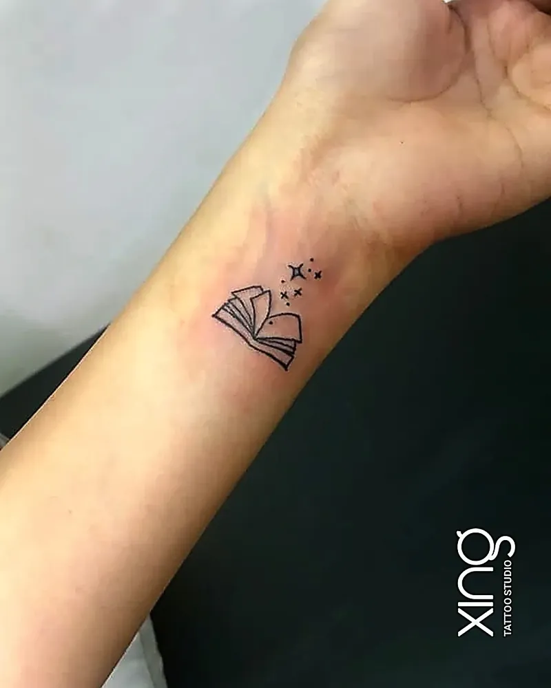
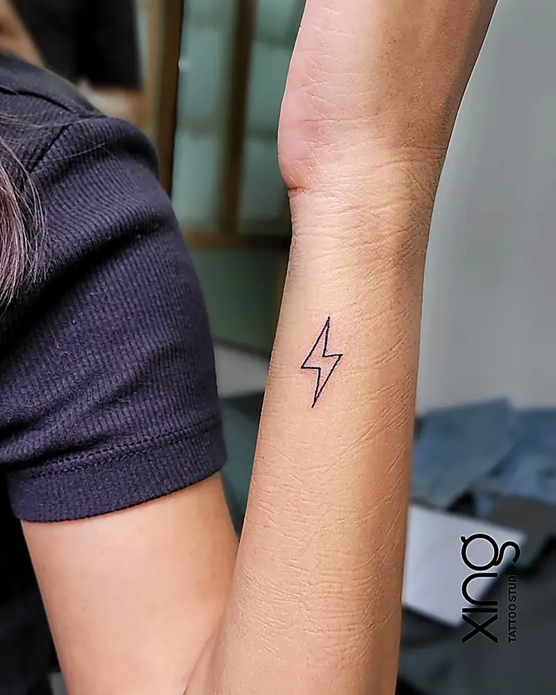

The best wrist tattoo ideas are small, simple and designed with slightly bolder lines so they stay sharp through daily hand washing, sun and movement. Think tiny symbols, a single word, a small flower, a date or a delicate line design.

The wrist is one of the most requested placements at our studio in Brookefield, Bengaluru — especially for first tattoos. It's visible when you want it to be, easy to cover with a watch, and perfect for something personal.

Here's how to choose a wrist tattoo that looks good for years.

## Popular wrist tattoo ideas

Wrist tattoos work best when they're small and clear. Some of the most popular ideas:

**Symbols**

- Infinity sign.
- Semicolon.
- Small heart or heart outline.
- Arrow.
- Om or lotus.
- Tiny anchor.

**Words and dates**

- A single word — "breathe", "faith", "hope", "strength".
- A name or initials.
- A date in numbers or Roman numerals.
- Coordinates.

**Nature**

- A small flower or single stem.
- A leaf or sprig.
- A tiny bird.
- A wave or mountain line.

**Celestial**

- Crescent moon.
- Small stars.
- Sun.
- Constellation.

## Inner vs outer wrist

| | Inner wrist | Outer wrist |
| --- | --- | --- |
| Faces | You | Others |
| Visibility | Visible to you; easy to cover with a watch | Visible to others when your hand rests |
| Pain | Medium; thin skin | Medium; over bone |
| Ageing | Fair; washing and movement | Fair; more sun |
| Good for | Words, dates, small symbols | Symbols, bands, small designs |

The inner wrist is the classic spot for words and dates you want to read yourself. The outer wrist suits symbols and small designs you want others to see.

## Small wrist tattoo size tips

A small wrist tattoo has to be small — but not too small.

- **Simple shapes** — a heart, star or arrow — can be very small.
- **Words** need enough height so letters don't close up.
- **Flowers and detailed designs** need more space.
- **Leave space between lines** so they don't merge as the tattoo ages.

Your artist will size the design on your wrist before tattooing. If they suggest going a little bigger, it's to keep it readable for years.

> **Peace's tip:** Hold your wrist the way you naturally do — resting on a table, holding your phone, wearing your watch. That's how you'll see your tattoo most of the time, so we'll angle the stencil to look right in that position.

## Pain and healing on the wrist

The wrist has thin skin close to tendons and bone, so it can feel a little sharper than the upper arm. The good news: most wrist tattoos take less than an hour.

**Healing tips for the wrist:**

- Wash gently and pat dry after washing your hands.
- Apply a very thin layer of aftercare product — you'll wash your hands often, so reapply after.
- Avoid watches, bracelets and tight cuffs for about two weeks.
- Be careful with hand sanitisers and harsh soaps near the tattoo.
- Keep it out of direct sun while healing.

Our [tattoo aftercare guide](/blog/tattoo-aftercare-guide) covers the full healing routine.

## Sun and washing exposure

Wrists face more daily wear than almost any other placement.

- **Hand washing** happens many times a day.
- **Sanitisers and soaps** can dry the skin.
- **Sun** hits the outer wrist on commutes and two-wheeler rides.
- **Movement** constantly stretches the skin.

Once healed, use sunscreen on your wrist tattoo and moisturise regularly. These small habits make a big difference.

## Line weight for longevity

Line weight — how thick the lines are — affects how long a wrist tattoo stays sharp.

- **Very fine lines** look delicate when fresh but may soften faster on the wrist.
- **Slightly bolder lines** hold up better to washing and movement.
- **Solid shapes** (like a filled heart) last longer than thin outlines.

A skilled fine-line artist can balance elegance with longevity. Our guide to [fine line tattoos](/blog/fine-line-tattoos) explains this in detail.

## Wrist tattoos and work

Wrist tattoos are easy to show or hide:

- A watch or bracelet covers most inner wrist tattoos.
- Long sleeves cover both inner and outer wrist designs.
- Small designs often go unnoticed in formal settings.

If you work in a strict dress-code environment, the inner wrist under a watch is a smart choice.

## Matching wrist tattoos

The wrist is the most popular spot for matching tattoos — with partners, siblings or best friends. Simple shared symbols, dates or words work beautifully. Our guide to [couple tattoo ideas](/blog/couple-tattoo-ideas) has more matching options.

## Wrist tattoo checklist

- [ ] I've chosen a simple design with personal meaning.
- [ ] I've decided between inner and outer wrist.
- [ ] I'm open to slightly bolder lines for longevity.
- [ ] I'll skip watches and bracelets while it heals.
- [ ] I'll use sunscreen once it's healed.

More small design ideas are in our list of [30 minimalist tattoo ideas](/blog/minimalist-tattoo-ideas).

## Wrist tattoo ideas with meaning

If you'd like your wrist tattoo to carry a story, here are a few ways to personalise a simple design:

- **A parent's or child's initial** beside a small heart.
- **A birth flower** for someone you love.
- **A date** that marks a turning point in your life.
- **A tiny Om, lotus or trishul** as a daily reminder of faith.
- **A semicolon** as a sign that your story continues.
- **A word in your mother tongue** that only you and your family will understand.

Keep the design simple enough to stay clear on a small canvas. Your artist can help you choose which details to keep and which to leave out.

## Bracelet-style wrist tattoos

Some people prefer a design that wraps partly around the wrist, like a delicate bracelet — a thin line, tiny beads, a vine or a row of small symbols. These look elegant but need careful planning, because the skin moves a lot as you rotate your hand. Your artist will check the stencil in several hand positions before starting.

## How we do it at Xing

At Xing, Peace designs wrist tattoos from scratch and sizes them on your wrist in your natural hand position. Lines are weighted to stay sharp through daily washing and sun, and you get clear aftercare guidance for the wrist.

Needles are single-use and opened in front of you, and inks are sealed and skin-tested. If any part heals unevenly, we offer a free touch-up. See our [fine-line and minimalist work](/services/minimalist).

## Conclusion

The best wrist tattoo ideas are simple, personal and designed to last. Choose inner or outer wrist based on who you want to see it, keep the design clear with slightly bolder lines, and protect it from sun and harsh soaps once healed.

If you're planning a small wrist tattoo in Bengaluru — from Brookefield or AECS Layout to Whitefield — come in for a free consultation and we'll find the right size and line weight for you.

Ready to talk about your idea? Book a free consultation at Xing {{landmark}} — or [WhatsApp us]({{whatsapp}}).
